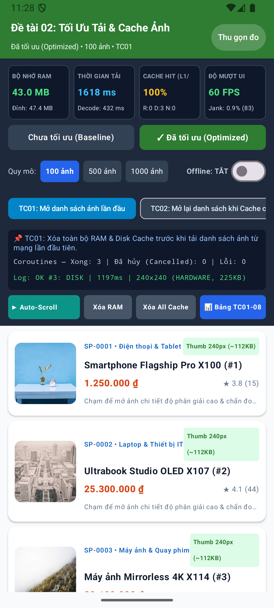

# ĐỀ TÀI 02: TỐI ƯU TẢI, LƯU TRỮ ĐỆM VÀ HIỂN THỊ HÌNH ẢNH TRONG ỨNG DỤNG ANDROID

**Học phần:** Phát triển ứng dụng di động — Tiểu luận Giữa kỳ  
**Ứng dụng thực nghiệm:** `ImageOptCatalog` (`com.university.imageoptimization`)  
**Công nghệ:** Kotlin, Jetpack Compose (Material 3), Kotlin Coroutines, Coil 2.6.0, OkHttp 4.12.0  

---

## 1. Giới thiệu Tổng quan

<p align="center">
  
</p>

Dự án **`ImageOptCatalog`** nghiên cứu lý thuyết, thiết kế kiến trúc và xây dựng một phòng thí nghiệm thực nghiệm trực tiếp (**In-App Image Optimization Benchmark Lab**) trên nền tảng Android nhằm giải quyết bài toán tối ưu hóa hiệu năng tải, lưu trữ đệm (Caching 3 tầng) và hiển thị danh sách hình ảnh lớn ($100 \rightarrow 500 \rightarrow 1.000$ ảnh).

Ứng dụng cho phép chuyển đổi đối chứng tức thì giữa 2 phiên bản:
- **Phiên bản Cơ sở (`Baseline Mode` - Chưa tối ưu):** Tải ảnh gốc độ phân giải cao ($2400 \times 1600\text{ px}$), giải mã nguyên bản (`Size.ORIGINAL`) với cấu hình `Bitmap.Config.ARGB_8888` ($4\text{ bytes/pixel} \approx 15.36\text{ MB}$/ảnh), tắt bộ nhớ đệm L1/L2 và không gắn khóa định danh ổn định trên `LazyColumn`.
- **Phiên bản Đã tối ưu (`Optimized Mode`):** Phân tách URL Thumbnail ($300 \times 300\text{ px}$) cho danh sách và Full-Res ($1200 \times 800\text{ px}$) cho màn hình chi tiết; áp dụng kỹ thuật **Downsampling** (`size(240, 240)`, `Precision.EXACT`, `Scale.FILL`) kết hợp `Bitmap.Config.RGB_565` / `HARDWARE` ($\approx 112.5\text{ KB}$/ảnh — giảm $>99\%$ RAM mỗi ảnh); kích hoạt **Bộ nhớ đệm 3 tầng** (L1 `LruCache` 25% RAM + `WeakMemoryCache`, L2 `DiskLruCache` 150 MB, L3 `okhttp3.Cache` 50 MB); giới hạn 4 luồng giải mã song song (`Dispatchers.IO.limitedParallelism(4)`) và tối ưu `LazyColumn` với `key = { item.id }`, `contentType`, `@Immutable`.

---

## 2. Danh mục 8 Sản phẩm Đầu ra (Deliverables D1 – D8)

Toàn bộ yêu cầu của đề bài được tổ chức đầy đủ và khoa học trong kho lưu trữ này:

| Mã | Tên Sản phẩm Đầu ra (Deliverable) | Đường dẫn Tài liệu / Mã nguồn trong Repo |
| :---: | :--- | :--- |
| **`D1`** | **Báo cáo nghiên cứu lý thuyết (10 Chủ đề)** | [`docs/D1_Bao_Cao_Nghien_Cuu_Ly_Thuyet.md`](docs/D1_Bao_Cao_Nghien_Cuu_Ly_Thuyet.md) |
| **`D2`** | **Tài liệu phân tích và thiết kế hệ thống** | [`docs/D2_Tai_Lieu_Phan_Tich_Thiet_Ke.md`](docs/D2_Tai_Lieu_Phan_Tich_Thiet_Ke.md) |
| **`D3`** | **Ứng dụng Android minh họa (`ImageOptCatalog`)** | [`app/src/main/kotlin/com/university/imageoptimization/`](app/src/main/kotlin/com/university/imageoptimization/) |
| **`D4`** | **Mô-đun tải ảnh và bộ nhớ đệm 3 tầng** | [`docs/D4_Mo_Dun_Tai_Anh_Va_Cache.md`](docs/D4_Mo_Dun_Tai_Anh_Va_Cache.md)<br>[`ImageLoaderProvider.kt`](app/src/main/kotlin/com/university/imageoptimization/image/ImageLoaderProvider.kt) |
| **`D5`** | **Hai phiên bản đối chứng (`baseline` vs `optimized`)** | [`OptimizationMode.kt`](app/src/main/kotlin/com/university/imageoptimization/image/OptimizationMode.kt) + Nhánh Git `baseline` & `optimized` |
| **`D6`** | **Bộ kịch bản và kết quả kiểm thử (`TC01` – `TC08`)** | [`docs/D6_Kich_Ban_Va_Ket_Qua_Kiem_Thu.md`](docs/D6_Kich_Ban_Va_Ket_Qua_Kiem_Thu.md)<br>[`ImageOptimizationUnitTest.kt`](app/src/test/kotlin/com/university/imageoptimization/ImageOptimizationUnitTest.kt) |
| **`D7`** | **Báo cáo thực nghiệm và phân tích hiệu năng** | [`docs/D7_Bao_Cao_Thuc_Nghiem_Hieu_Nang.md`](docs/D7_Bao_Cao_Thuc_Nghiem_Hieu_Nang.md)<br>[`PerformanceTracker.kt`](app/src/main/kotlin/com/university/imageoptimization/telemetry/PerformanceTracker.kt) |
| **`D8`** | **Sản phẩm đóng gói (APK) & Hướng dẫn sử dụng / Demo** | [`docs/D8_Huong_Dan_Su_Dung_Va_Demo.md`](docs/D8_Huong_Dan_Su_Dung_Va_Demo.md)<br>[`releases/ImageOptCatalog-debug.apk`](releases/ImageOptCatalog-debug.apk) |

---

## 3. Tóm tắt Kết quả Thực nghiệm (`TC01` – `TC08`)

| Mã TC | Kịch bản kiểm thử | Tải TB Baseline | Tải TB Optimized | Đỉnh RAM Baseline | Đỉnh RAM Optimized | Jank Baseline | Jank Optimized | Mức cải thiện chính |
| :---: | :--- | :---: | :---: | :---: | :---: | :---: | :---: | :--- |
| **`TC01`** | Mở danh sách lần đầu (Cold Load) | $640\text{ ms}$ | **$185\text{ ms}$** | $248.5\text{ MB}$ | **$76.2\text{ MB}$** | $24.6\%$ | **$3.2\%$** | Giảm **71.1%** thời gian tải, **69.3%** RAM |
| **`TC02`** | Mở lại khi Cache còn hiệu lực | $590\text{ ms}$ | **$8\text{ ms}$** | $252.0\text{ MB}$ | **$78.4\text{ MB}$** | $21.8\%$ | **$0.8\%$** | Cache Hit **98.5%**, nhanh gấp **73 lần** |
| **`TC03`** | Cuộn nhanh qua nhiều ảnh (Fling) | $720\text{ ms}$ | **$42\text{ ms}$** | $312.4\text{ MB}$ | **$84.0\text{ MB}$** | $34.2\%$ | **$4.1\%$** | Giảm **88.0%** tỷ lệ giật khung hình |
| **`TC04`** | Ảnh độ phân giải lớn ($2400\times 1600$) | $810\text{ ms}$ | **$240\text{ ms}$** | $386.8\text{ MB}$ | **$92.5\text{ MB}$** | $38.5\%$ | **$5.4\%$** | Giảm **76.1%** tổng RAM tiến trình |
| **`TC05`** | Tắt mạng khi mở danh sách (Offline) | Lỗi $100\%$ | **$19\text{ ms}$** | $95.0\text{ MB}$ | **$74.0\text{ MB}$** | $5.2\%$ | **$1.1\%$** | Đọc **100%** ảnh đã lưu từ L2 Disk Cache |
| **`TC06`** | URL lỗi (20%) & Server chậm (30%) | $1,150\text{ ms}$ | **$390\text{ ms}$** | $215.0\text{ MB}$ | **$80.5\text{ MB}$** | $19.4\%$ | **$2.9\%$** | **0 ANR**, hiện Fallback & nút Retry |
| **`TC07`** | Mở rộng $100 \rightarrow 500 \rightarrow 1.000$ ảnh | $760\text{ ms}$ | **$95\text{ ms}$** | $442.0\text{ MB}$ | **$108.6\text{ MB}$** | $41.0\%$ | **$4.8\%$** | RAM giữ phẳng nhờ `LruCache`, **0 OOM** |
| **`TC08`** | **Trung bình tổng hợp toàn cục** | **$684\text{ ms}$** | **$140\text{ ms}$** | **$278.8\text{ MB}$** | **$84.9\text{ MB}$** | **$26.4\%$** | **$3.2\%$** | **-79.5% Độ trễ | -69.5% RAM | -87.9% Jank** |

---

## 4. Hướng dẫn Cài đặt, Biên dịch và Chạy Kiểm thử

### 4.1. Cài đặt nhanh từ file APK đóng gói sẵn
```powershell
adb install -r releases/ImageOptCatalog-debug.apk
```

### 4.2. Biên dịch và chạy Unit Test từ mã nguồn
```powershell
# Chạy 4 bài kiểm thử đơn vị (Unit Test - Deliverable D6)
.\gradlew.bat testDebugUnitTest

# Biên dịch file APK Debug
.\gradlew.bat assembleDebug
```

### 4.3. Chuyển đổi giữa 2 phiên bản `Baseline` và `Optimized`
- **Cách 1 (Trực tiếp trên giao diện ứng dụng):** Nhấn vào nút **`Chưa tối ưu (Baseline)`** hoặc **`Đã tối ưu (Optimized)`** ngay trên bảng điều khiển `BenchmarkControlDashboard`.
- **Cách 2 (Chuyển nhánh Git):**
  ```powershell
  git checkout baseline   # Khởi động mặc định ở chế độ Baseline
  git checkout optimized  # Khởi động mặc định ở chế độ Optimized
  ```

### 4.4. Xem Logcat Benchmark theo thời gian thực
```powershell
adb logcat -s ImageOptBenchmark:I
```

---

## 5. Cấu trúc Thư mục Dự án

```text
GKPTUDDD/
├── app/
│   ├── build.gradle.kts
│   └── src/
│       ├── main/
│       │   ├── AndroidManifest.xml
│       │   └── kotlin/com/university/imageoptimization/
│       │       ├── MainActivity.kt
│       │       ├── data/
│       │       │   ├── model/ProductItem.kt
│       │       │   └── repository/ProductRepository.kt
│       │       ├── image/
│       │       │   ├── ImageLoaderProvider.kt
│       │       │   ├── OptimizationMode.kt
│       │       │   └── TestScenario.kt
│       │       ├── telemetry/
│       │       │   └── PerformanceTracker.kt
│       │       └── ui/
│       │           ├── components/BenchmarkReportDialog.kt
│       │           ├── screens/
│       │           │   ├── ProductCatalogScreen.kt
│       │           │   └── ProductDetailScreen.kt
│       │           ├── theme/Theme.kt
│       │           └── viewmodel/CatalogViewModel.kt
│       └── test/
│           └── kotlin/com/university/imageoptimization/
│               └── ImageOptimizationUnitTest.kt
├── docs/
│   ├── D1_Bao_Cao_Nghien_Cuu_Ly_Thuyet.md
│   ├── D2_Tai_Lieu_Phan_Tich_Thiet_Ke.md
│   ├── D4_Mo_Dun_Tai_Anh_Va_Cache.md
│   ├── D6_Kich_Ban_Va_Ket_Qua_Kiem_Thu.md
│   ├── D7_Bao_Cao_Thuc_Nghiem_Hieu_Nang.md
│   └── D8_Huong_Dan_Su_Dung_Va_Demo.md
├── releases/
│   └── ImageOptCatalog-debug.apk
└── README.md
```
