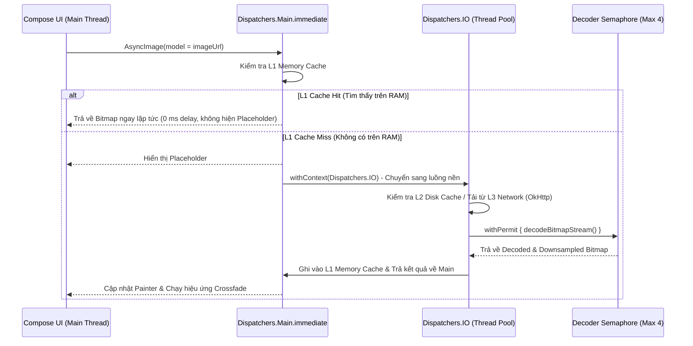
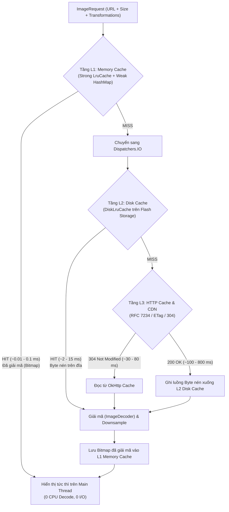
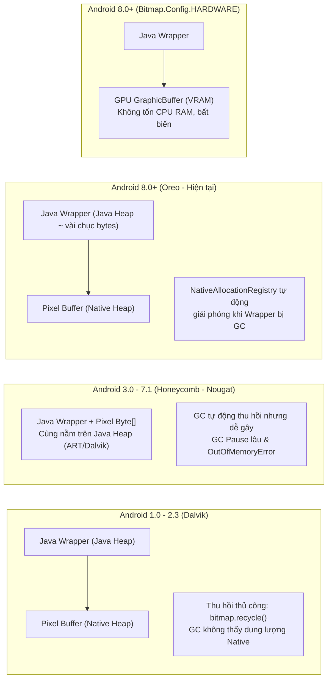
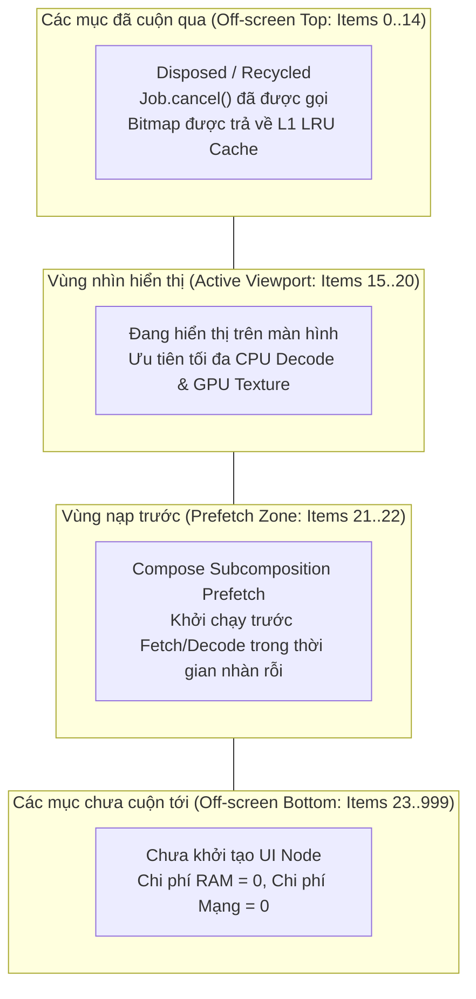

# BÁO CÁO NGHIÊN CỨU LÝ THUYẾT (DELIVERABLE D1)

**Đề tài 02:** Tối ưu tải, lưu trữ đệm và hiển thị hình ảnh trong ứng dụng Android  
**Học phần:** Phát triển ứng dụng di động  
**Ứng dụng thực nghiệm:** `ImageOptCatalog` (`com.university.imageoptimization`)  
**Công nghệ trọng tâm:** Kotlin, Jetpack Compose, Kotlin Coroutines, Coil (Coroutine Image Loader) 2.6.0, OkHttp 4.12.0  

---

## TÓM TẮT HỌC THUẬT (ABSTRACT)

Trong phát triển ứng dụng di động hiện đại trên nền tảng Android, hình ảnh chiếm tỷ trọng lớn nhất về băng thông mạng, dung lượng lưu trữ cục bộ và bộ nhớ khả kiến (RAM). Việc xử lý hình ảnh thiếu tối ưu — chẳng hạn như giải mã ảnh độ phân giải gốc (Full-Resolution) mà không hạ mẫu (Downsampling), thực thi tác vụ I/O hoặc giải mã trên luồng giao diện chính (Main/UI Thread), hoặc bỏ qua cơ chế bộ nhớ đệm đa tầng — là nguyên nhân hàng đầu dẫn đến hiện tượng rớt khung hình (Jank/Frame Drop), treo ứng dụng (`Application Not Responding - ANR`) và tràn bộ nhớ (`java.lang.OutOfMemoryError - OOM`).

Báo cáo nghiên cứu lý thuyết này hệ thống hóa toàn diện cơ sở khoa học và kỹ thuật của quy trình xử lý hình ảnh trên Android qua 10 chủ đề cốt lõi: (1) Quy trình 5 bước tải và kết xuất ảnh từ tầng mạng đến GPU Texture; (2) Mô hình lập trình bất đồng bộ và đồng시 có cấu trúc (Structured Concurrency) với Kotlin Coroutines; (3) Kiến trúc bộ nhớ đệm 3 tầng (L1 Memory Cache, L2 Disk Cache, L3 HTTP Cache); (4) Đặc tính nén và chi phí giải mã của các định dạng JPEG, PNG, WebP; (5) Cơ chế quản lý bộ nhớ `Bitmap` trên máy ảo ART, hiện tượng Memory Churn và Garbage Collection; (6) Cơ chế tải ảnh theo nhu cầu (Lazy Loading) và Prefetching; (7) Tối ưu hóa kết xuất danh sách lớn trên Jetpack Compose `LazyColumn`; (8) Các chiến lược tối ưu hóa toàn diện trong Coil; (9) Hệ thống công cụ đo lường, phân tích hiệu năng (Profiling & Telemetry); và (10) Phương pháp luận thiết kế thực nghiệm có kiểm soát.

---

## MỤC LỤC

1. [Chủ đề 1: Cơ chế tải và hiển thị ảnh trên Android](#chủ-đề-1-cơ-chế-tải-và-hiển-thị-ảnh-trên-android)
2. [Chủ đề 2: Lập trình bất đồng bộ với Kotlin Coroutines](#chủ-đề-2-lập-trình-bất-đồng-bộ-với-kotlin-coroutines)
3. [Chủ đề 3: Cơ chế bộ nhớ đệm (Caching) 3 tầng](#chủ-đề-3-cơ-chế-bộ-nhớ-đệm-caching-3-tầng)
4. [Chủ đề 4: Định dạng và giải mã ảnh](#chủ-đề-4-định-dạng-và-giải-mã-ảnh)
5. [Chủ đề 5: Quản lý bộ nhớ Android](#chủ-đề-5-quản-lý-bộ-nhớ-android)
6. [Chủ đề 6: Tải ảnh theo nhu cầu (Lazy Loading)](#chủ-đề-6-tải-ảnh-theo-nhu-cầu-lazy-loading)
7. [Chủ đề 7: Tối ưu giao diện với Jetpack Compose LazyColumn](#chủ-đề-7-tối-ưu-giao-diện-với-jetpack-compose-lazycolumn)
8. [Chủ đề 8: Các chiến lược tối ưu ảnh](#chủ-đề-8-các-chiến-lược-tối-ưu-ảnh)
9. [Chủ đề 9: Công cụ phân tích hiệu năng](#chủ-đề-9-công-cụ-phân-tích-hiệu-năng)
10. [Chủ đề 10: Phương pháp thực nghiệm](#chủ-đề-10-phương-pháp-thực-nghiệm)
11. [Danh mục Tài liệu tham khảo](#danh-mục-tài-liệu-tham-khảo)

---

## Chủ đề 1: Cơ chế tải và hiển thị ảnh trên Android

### 1.1. Tổng quan đường ống xử lý ảnh (Image Processing Pipeline)

Một tệp ảnh tồn tại trên máy chủ web dưới dạng luồng byte được nén (compressed byte stream, ví dụ: JPEG hoặc WebP). Tuy nhiên, bộ xử lý đồ họa (GPU) và màn hình thiết bị chỉ có thể hiển thị ma trận điểm ảnh chưa nén (uncompressed pixel buffer / GPU Texture). Do đó, để biến một chuỗi địa chỉ URL thành hình ảnh hiển thị trên màn hình, hệ thống Android và thư viện tải ảnh (như Coil) phải thực thi một đường ống (pipeline) gồm **5 giai đoạn tuần tự**:

```mermaid
flowchart LR
    subgraph Step1["Bước 1: Khởi tạo & Định tuyến"]
        A["URL / ImageRequest"] --> B["Resolve Size & Check L1 Cache"]
    end
    subgraph Step2["Bước 2: Kết nối HTTP & Luồng I/O"]
        B -->|Cache Miss| C["OkHttp Connection Pool"]
        C --> D["BufferedSource Stream (L2/L3)"]
    end
    subgraph Step3["Bước 3: Giải mã (Decoding)"]
        D --> E["ImageDecoder / BitmapFactory"]
        E --> F["Subsampling (inSampleSize)"]
    end
    subgraph Step4["Bước 4: Biến đổi (Transformation)"]
        F --> G["Scale / Crop / Circle / Rounded"]
        G --> H["Decoded Bitmap in Native Heap"]
    end
    subgraph Step5["Bước 5: Upload GPU & Render"]
        H --> I["RenderThread: Upload Texture"]
        I --> J["Skia / Vulkan / OpenGL ES"]
        J --> K["SurfaceFlinger -> Display"]
    end
```



### 1.2. Phân tích chuyên sâu 5 bước trong Pipeline

#### Bước 1: Khởi tạo yêu cầu và xác định kích thước đích (Request Initialization & Size Resolution)
Khi thành phần giao diện (`AsyncImage` trong Jetpack Compose hoặc `ImageView` trong View System) yêu cầu hiển thị một URL, thư viện tải ảnh đóng gói thông tin vào đối tượng bất biến `ImageRequest`. Trước khi thực hiện bất kỳ thao tác mạng nào, hệ thống phải:
- **Xác định kích thước khung chứa (`SizeResolver`):** Đợi cho đến khi pha Layout (Measure/Layout pass) của Compose hoàn tất để biết chính xác chiều rộng $W_{\text{target}}$ và chiều cao $H_{\text{target}}$ (tính bằng pixel vật lý) của vùng hiển thị.
- **Tạo khóa định danh (`MemoryCache.Key`):** Kết hợp URL, kích thước đích, cấu hình `Parameters` và danh sách `Transformation` để kiểm tra nhanh trên tầng bộ nhớ đệm L1 (RAM). Nếu tìm thấy (`Cache Hit`), quy trình nhảy thẳng đến **Bước 5**.

#### Bước 2: Kết nối HTTP và truyền tải luồng dữ liệu (HTTP Network Fetching via OkHttp Stream)
Nếu dữ liệu không có trong RAM và Disk Cache, `HttpUriFetcher` sử dụng `OkHttpClient` để tải dữ liệu từ máy chủ:
- **Tái sử dụng kết nối (Connection Pooling & HTTP/2 Multiplexing):** Thay vì bắt tay TCP 3 bước (3-way handshake) và TLS handshake cho từng ảnh (tiốn từ $100\text{ ms} - 300\text{ ms}$), OkHttp duy trì một `ConnectionPool` và ghép kênh (multiplex) nhiều luồng tải ảnh đồng thời trên một kết nối TCP duy nhất thông qua giao thức HTTP/2.
- **Đọc dữ liệu theo luồng (`okio.BufferedSource`):** Dữ liệu phản hồi (`ResponseBody`) không được nạp toàn bộ vào một mảng `ByteArray` khổng lồ trên Java Heap (điều này dễ gây tràn bộ nhớ với ảnh lớn), mà được truyền qua bộ đệm luồng `BufferedSource` của thư viện Okio với các khối (segments) kích thước cố định $8\text{ KB}$, ghi trực tiếp xuống Disk Cache hoặc chuyển giao cho bộ giải mã.

#### Bước 3: Giải mã luồng byte nén thành ma trận điểm ảnh (Image Decoding)
Luồng byte nén từ đĩa hoặc mạng được đưa vào bộ giải mã phần cứng/phần mềm của hệ điều hành Android (`BitmapFactory` trên Android $\le$ 8.1 hoặc `android.graphics.ImageDecoder` từ Android 9.0 - API 28 trở lên):
- **Đọc Header ảnh (`inJustDecodeBounds = true`):** Bộ giải mã chỉ đọc vài chục byte đầu tiên của file (ví dụ: SOF0 marker trong JPEG hoặc VP8X chunk trong WebP) để trích xuất kích thước gốc $(W_{\text{src}}, H_{\text{src}})$ và không gian màu (Color Space) mà **không cấp phát bộ nhớ cho điểm ảnh**.
- **Tính toán hệ số hạ mẫu (`inSampleSize`):** Dựa trên tỷ lệ giữa $(W_{\text{src}}, H_{\text{src}})$ và $(W_{\text{target}}, H_{\text{target}})$, bộ giải mã chỉ đọc mỗi điểm ảnh thứ $k$ theo cả hai chiều, giúp giảm lượng điểm ảnh cần giải mã đi $k^2$ lần ngay tại tầng C/C++ (`libjpeg-turbo`, `libwebp`, `libpng`).
- **Giới hạn đồng thời (`Semaphore`):** Quá trình giải mã tiêu tốn rất nhiều chu kỳ CPU và cấp phát bộ nhớ tức thời lớn. Coil sử dụng `Semaphore(maxPermits = 4)` trong `BitmapFactoryDecoder` để giới hạn tối đa 4 luồng giải mã chạy song song, ngăn chặn hiện tượng tranh chấp CPU và tăng vọt RAM (Memory Spike).

#### Bước 4: Xử lý hậu kỳ và biến đổi hình học (Post-processing & Transformations)
Sau khi có đối tượng `Bitmap` thô từ bộ giải mã, nếu yêu cầu có gắn kèm các bộ biến đổi (`Transformation` như `CircleCropTransformation`, `RoundedCornersTransformation`, `BlurTransformation`), hệ thống sẽ:
- Khởi tạo một đối tượng `Bitmap` mới hoặc vẽ lại lên `android.graphics.Canvas` bằng `Paint` có bật cờ khử răng cưa (`Paint.ANTI_ALIAS_FLAG`) và `BitmapShader`.
- Áp dụng ma trận co giãn (`Matrix.setScale`) theo chế độ `Scale.FILL` (tương đương `ContentScale.Crop`) hoặc `Scale.FIT` (tương đương `ContentScale.Fit`) để khớp chính xác kích thước đích nếu `Precision.EXACT` được yêu cầu.
- Lưu trữ `Bitmap` hoàn chỉnh vào tầng L1 Memory Cache.

#### Bước 5: Tải lên GPU Texture và kết xuất lên màn hình (GPU Texture Upload & Display Rendering)
Khi `Bitmap` đã sẵn sàng và được trả về `Main Thread`, nó vẫn nằm trên bộ nhớ hệ thống (System RAM / Native Heap) hoặc bộ nhớ đồ họa chia sẻ:
- **Ghi nhận lệnh vẽ (DisplayList Recording):** Trên `Main Thread`, Jetpack Compose thực thi pha Drawing (`DrawScope.drawImage`), ghi lệnh vẽ bitmap vào cấu trúc `RenderNode` / `DisplayList` của hệ thống tăng tốc phần cứng (`HWUI`).
- **Đồng bộ hóa và Upload Texture (`RenderThread`):** Luồng kết xuất chuyên biệt `RenderThread` tiếp nhận `DisplayList`. Nếu `Bitmap` là loại thông thường (`ARGB_8888` hoặc `RGB_565` nằm trên CPU RAM), `RenderThread` phải gọi hàm `glTexImage2D` (OpenGL ES) hoặc truyền qua staging buffer (Vulkan) để sao chép mảng pixel từ CPU sang bộ nhớ GPU Texture. Ngược lại, nếu sử dụng `Bitmap.Config.HARDWARE` (Android 8.0+), dữ liệu ảnh đã được giải mã trực tiếp vào bộ đệm phần cứng `GraphicBuffer` (`AHardwareBuffer`) ngay từ Bước 3, nên bước upload tốn chi phí bằng $0$.
- **Tổng hợp khung hình (`SurfaceFlinger`):** Cuối cùng, GPU kết xuất (rasterize) Texture lên bộ đệm khung hình (`FrameBuffer`) và tiến trình hệ thống `SurfaceFlinger` ghép các lớp giao diện để phát ra màn hình theo tín hiệu đồng bộ dọc (`VSYNC`).

### 1.3. Minh họa mã nguồn Kotlin/Coil theo dõi toàn bộ 5 bước Pipeline

```kotlin
package com.university.imageoptimization.pipeline

import android.content.Context
import android.graphics.Bitmap
import android.util.Log
import coil.EventListener
import coil.ImageLoader
import coil.decode.DecodeResult
import coil.decode.Decoder
import coil.fetch.FetchResult
import coil.fetch.Fetcher
import coil.request.ImageRequest
import coil.request.Options
import coil.size.Size

/**
 * Minh họa cơ chế theo dõi toàn bộ 5 bước trong Pipeline tải và hiển thị ảnh của Coil.
 */
class PipelineTraceEventListener : EventListener {

    // Bước 1: Khởi tạo yêu cầu & Phân giải kích thước vùng hiển thị
    override fun onStart(request: ImageRequest) {
        Log.d(TAG, "[Step 1] Start Request: ${request.data}")
    }

    override fun resolveSizeStart(request: ImageRequest, sizeResolver: coil.size.SizeResolver) {
        Log.d(TAG, "[Step 1] Resolving target viewport size...")
    }

    override fun resolveSizeEnd(request: ImageRequest, size: Size) {
        Log.d(TAG, "[Step 1] Resolved Size: $size")
    }

    // Bước 2: Kết nối HTTP / Đọc luồng từ Disk (Fetcher)
    override fun fetchStart(request: ImageRequest, fetcher: Fetcher, options: Options) {
        Log.d(TAG, "[Step 2] Fetching stream via ${fetcher::class.simpleName} on ${Thread.currentThread().name}")
    }

    override fun fetchEnd(request: ImageRequest, fetcher: Fetcher, options: Options, result: FetchResult?) {
        Log.d(TAG, "[Step 2] Fetch complete: dataSource=${result?.let { it::class.simpleName }}")
    }

    // Bước 3: Giải mã luồng byte thành Bitmap (Decoder)
    override fun decodeStart(request: ImageRequest, decoder: Decoder, options: Options) {
        Log.d(TAG, "[Step 3] Decoding via ${decoder::class.simpleName} (Config=${options.config}, Scale=${options.scale})")
    }

    override fun decodeEnd(request: ImageRequest, decoder: Decoder, options: Options, result: DecodeResult?) {
        Log.d(TAG, "[Step 3] Decode finished: isSampled=${result?.isSampled}")
    }

    // Bước 4: Xử lý biến đổi hình ảnh (Transformations)
    override fun transformStart(request: ImageRequest, input: Bitmap) {
        Log.d(TAG, "[Step 4] Transform start: input=${input.width}x${input.height} (${input.AllocationByteCount} bytes)")
    }

    override fun transformEnd(request: ImageRequest, output: Bitmap) {
        Log.d(TAG, "[Step 4] Transform end: output=${output.width}x${output.height}")
    }

    // Bước 5: Chuyển giao cho Main Thread & RenderThread kết xuất lên GPU/Canvas
    override fun transitionStart(request: ImageRequest, transition: coil.transition.Transition) {
        Log.d(TAG, "[Step 5] Transition & GPU Upload started on ${Thread.currentThread().name}")
    }

    override fun onSuccess(request: ImageRequest, result: coil.request.SuccessResult) {
        Log.d(TAG, "[Step 5] Rendered from ${result.dataSource} | Sampled=${result.isSampled}")
    }

    companion object {
        private const val TAG = "ImagePipelineTrace"
    }
}
```

---

## Chủ đề 2: Lập trình bất đồng bộ với Kotlin Coroutines

### 2.1. Tại sao tuyệt đối không tải và giải mã ảnh trên Main Thread?

Kiến trúc giao diện người dùng của Android tuân theo mô hình **Đơn luồng (Single-Threaded UI Model)**. Mọi thao tác xử lý sự kiện chạm (Touch Input), đo đạc bố cục (Measure & Layout), thực thi hàm `@Composable` (Composition/Recomposition) và ghi nhận lệnh vẽ (Draw) đều diễn ra trên một luồng duy nhất gọi là **Main Thread (hay UI Thread)**, được điều phối bởi vòng lặp tin nhắn `Looper` và `Choreographer`.

#### 1. Ngưỡng thời gian khung hình (Frame Budget) và hiện tượng Jank
Màn hình thiết bị di động hiện đại làm tươi ở tần số $f = 60\text{ Hz}$, $90\text{ Hz}$ hoặc $120\text{ Hz}$. Khoảng thời gian tối đa để hoàn thành một khung hình ($T_{\text{frame}}$) được xác định bởi công thức:

$$T_{\text{frame}} = \frac{1000\text{ ms}}{f}$$

- Với màn hình **60 Hz**: $T_{\text{frame}} = \frac{1000}{60} \approx \mathbf{16.67\text{ ms}}$.
- Với màn hình **90 Hz**: $T_{\text{frame}} = \frac{1000}{90} \approx \mathbf{11.11\text{ ms}}$.
- Với màn hình **120 Hz**: $T_{\text{frame}} = \frac{1000}{120} \approx \mathbf{8.33\text{ ms}}$.

Trong khi đó:
- Một yêu cầu mạng tải ảnh qua 4G/Wi-Fi mất trung bình từ $50\text{ ms}$ đến $800\text{ ms}$.
- Việc giải mã một bức ảnh JPEG kích thước $4000 \times 3000\text{ px}$ trên CPU di động mất khoảng $45\text{ ms} - 120\text{ ms}$.

Nếu thực hiện giải mã một ảnh $4000 \times 3000\text{ px}$ (tốn $80\text{ ms}$) trực tiếp trên Main Thread, luồng chính sẽ bị chặn (block) qua:

$$\text{Dropped Frames} = \left\lfloor \frac{T_{\text{task}}}{T_{\text{frame}}} \right\rfloor = \left\lfloor \frac{80\text{ ms}}{16.67\text{ ms}} \right\rfloor = 4\text{ khung hình liên tiếp (tại 60 Hz)}$$

Người dùng sẽ cảm nhận ngay lập tức hiện tượng khựng, giật cục (Jank / Stutter) khi vuốt danh sách. Hơn nữa, kể từ Android 3.0 (API 11), việc thực hiện kết nối mạng trên Main Thread sẽ ngay lập tức ném ra ngoại lệ `android.os.NetworkOnMainThreadException`.

#### 2. Nguy cơ treo ứng dụng (`Application Not Responding - ANR`)
Hệ thống giám sát `InputDispatcher` và `ActivityManagerService` của Android áp đặt giới hạn cứng cho khả năng phản hồi của Main Thread:
- Nếu Main Thread bị chặn và không thể phản hồi một sự kiện đầu vào của người dùng (chạm, vuốt, nhấn phím) trong vòng **$\ge 5000\text{ ms}$ (5 giây)**, hệ điều hành sẽ kích hoạt hộp thoại lỗi **ANR (Application Not Responding)** và buộc đóng ứng dụng, làm suy giảm nghiêm trọng chỉ số Android Vitals trên Google Play Console.

### 2.2. Cơ chế phân phối luồng: `Dispatchers.IO` vs `Dispatchers.Default` vs `Dispatchers.Main.immediate`

Kotlin Coroutines cung cấp cơ chế lập lịch hợp tác (cooperative multitasking) thông qua các `CoroutineDispatcher` chuyên biệt để tách biệt công việc khỏi Main Thread:

| Tiêu chí kỹ thuật | `Dispatchers.Main` / `Dispatchers.Main.immediate` | `Dispatchers.IO` | `Dispatchers.Default` |
| :--- | :--- | :--- | :--- |
| **Bản chất luồng nền tảng** | Gắn trực tiếp với `Looper.getMainLooper()` của Android (`HandlerContext`). | Nhóm luồng co giãn (Elastic Thread Pool) chia sẻ kiến trúc với `Default`. | Nhóm luồng kích thước cố định (Fixed Thread Pool) tối ưu cho CPU. |
| **Số lượng luồng tối đa** | $1$ luồng duy nhất (`main`). | $\max(64, N_{\text{cores}})$ (mặc định tối소 64 luồng). | $\max(2, N_{\text{cores}})$ (bằng số nhân CPU vật lý, ví dụ 8 luồng). |
| **Đặc điểm tác vụ phù hợp** | Cập nhật State giao diện, kích hoạt Recomposition, khởi chạy Animation. | Tác vụ chờ I/O (I/O-bound): Tải mạng HTTP, đọc/ghi Disk Cache, giải mã luồng file. | Tác vụ tính toán nặng (CPU-bound): Biến đổi ma trận pixel lớn, lọc ảnh phức tạp. |
| **Hành vi lập lịch** | `.Main` luôn đưa `Runnable` vào cuối hàng đợi `MessageQueue`. `.Main.immediate` kiểm tra nếu đang ở Main Thread thì **thực thi ngay lập tức** không tốn chi phí xếp hàng (dispatch overhead). | Cho phép nhiều luồng bị block chờ phần cứng mạng/đĩa mà không làm cạn kiệt luồng xử lý của toàn ứng dụng. | Giới hạn số luồng bằng số lõi CPU để giảm thiểu chi phí chuyển ngữ cảnh (`Context Switch`). |

**Vai trò đặc biệt của `Dispatchers.Main.immediate` trong Coil:**  
Khi một bức ảnh đã có sẵn trong tầng **L1 Memory Cache**, nếu Coil sử dụng `Dispatchers.Main`, yêu cầu lấy ảnh sẽ bị đẩy vào hàng đợi `Looper` và phải đợi đến khung hình kế tiếp mới được thực thi — khiến màn hình chớp (flicker) hiển thị `Placeholder` trong 1 khung hình trước khi hiện ảnh thật. Nhờ sử dụng `Dispatchers.Main.immediate`, Coil kiểm tra bộ nhớ đệm L1 đồng bộ ngay trên Main Thread trong cùng một khung hình, trả về `Bitmap` tức thì mà không qua bất kỳ bước chuyển ngữ cảnh (context switch) nào.



### 2.3. Đồng thời có cấu trúc (Structured Concurrency) và cơ chế tự động hủy (`Job.cancel()`)

Trong các danh sách cuộn tốc độ cao (`LazyColumn` hoặc `RecyclerView`), người dùng có thể cuộn qua hàng trăm mục chỉ trong vài giây. Nếu các tác vụ tải ảnh của những mục đã trôi khỏi màn hình vẫn tiếp tục chạy ngầm, chúng sẽ gây ra 3 hậu quả nghiêm trọng:
1. **Nghẽn cổ chai băng thông và luồng giải mã (Thread/Bandwidth Starvation):** Các ảnh ở mục thứ 1–50 (đã cuộn qua) chiếm hết băng thông mạng và 4 slot `Semaphore` giải mã, khiến ảnh ở mục thứ 51 (đang nằm trước mắt người dùng) phải xếp hàng chờ đợi.
2. **Rò rỉ bộ nhớ (Memory Leak):** Tác vụ nền giữ tham chiếu ngược (implicit reference) tới `View` hoặc `Context` đã bị hủy.
3. **Hiển thị sai ảnh (Image Flickering / Wrong Image Bug):** Trong `RecyclerView`, khi `ViewHolder` được tái sử dụng cho mục mới, nếu request cũ hoàn tất muộn hơn request mới và ghi đè lên `ImageView`, người dùng sẽ thấy ảnh của sản phẩm A hiển thị nhầm vào ô của sản phẩm B.

#### Cơ chế giải quyết bằng Structured Concurrency:
Mỗi yêu cầu tải ảnh trong Coil được gắn chặt với một `Job` con nằm trong `CoroutineScope` của vòng đời thành phần giao diện:
- **Trong Jetpack Compose (`AsyncImagePainter`):** `AsyncImagePainter` triển khai giao diện `RememberObserver`. Khi một mục trong `LazyColumn` nằm trong vùng nhìn, hàm `onRemembered()` được gọi và khởi tạo một `CoroutineScope` riêng để chạy `imageLoader.execute(request)`. Ngay khi người dùng cuộn mục đó ra khỏi vùng nhìn (rời khỏi Composition), Compose Runtime tự động gọi `onForgotten()` $\rightarrow$ kích hoạt `scope.cancel()` $\rightarrow$ hủy `Job` tải ảnh.
- **Cơ chế hủy hợp tác (Cooperative Cancellation):** Khi `Job.cancel()` được gọi:
  - Nếu đang ở **Bước 2 (Tải mạng)**: `ContinuationInterceptor` của OkHttp (`suspendCancellableCoroutine`) bắt sự kiện `invokeOnCancellation { call.cancel() }`, đóng luồng socket hoặc hủy stream HTTP/2 ngay lập tức.
  - Nếu đang chờ tới lượt ở **Bước 3 (Semaphore Giải mã)**: Coroutine bị loại khỏi hàng đợi của `Semaphore` mà không bao giờ bước vào hàm giải mã tốn CPU.
  - Nếu đang ở **Bước 4 (Transformation)**: Hàm kiểm tra `ensureActive()` sẽ ném `CancellationException` để giải phóng `Bitmap` trung gian ngay lập tức.

```kotlin
package com.university.imageoptimization.coroutines

import coil.ImageLoader
import coil.request.Disposable
import coil.request.ImageRequest
import kotlinx.coroutines.CancellationException
import kotlinx.coroutines.CoroutineScope
import kotlinx.coroutines.Dispatchers
import kotlinx.coroutines.SupervisorJob
import kotlinx.coroutines.cancel
import kotlinx.coroutines.launch
import kotlinx.coroutines.suspendCancellableCoroutine
import okhttp3.Call
import okhttp3.Callback
import okhttp3.Response
import java.io.IOException
import kotlin.coroutines.resume
import kotlin.coroutines.resumeWithException

/**
 * Minh họa cách chuyển đổi OkHttp Call sang Coroutine có hỗ trợ hủy tức thì (Cancellation)
 * và quản lý vòng đời theo Structured Concurrency.
 */
suspend fun Call.awaitResponse(): Response = suspendCancellableCoroutine { continuation ->
    // Đăng ký callback hủy: Khi Job.cancel() được gọi khi cuộn nhanh,
    // OkHttp Call sẽ bị ngắt kết nối ngay lập tức.
    continuation.invokeOnCancellation {
        try {
            cancel()
        } catch (_: Throwable) {}
    }

    enqueue(object : Callback {
        override fun onResponse(call: Call, response: Response) {
            continuation.resume(response)
        }

        override fun onFailure(call: Call, e: IOException) {
            if (!continuation.isCancelled) {
                continuation.resumeWithException(e)
            }
        }
    })
}
```

---

## Chủ đề 3: Cơ chế bộ nhớ đệm (Caching) 3 tầng

Để tối thiểu hóa độ trễ hiển thị và triệt tiêu lưu lượng mạng dư thừa, kiến trúc tải ảnh chuẩn mực trên Android áp dụng mô hình **Bộ nhớ đệm phân cấp 3 tầng (Three-Tier Hierarchical Caching)**: **L1 Memory Cache**, **L2 Disk Cache** và **L3 HTTP/Network Cache**.



### 3.1. Phân tích kiến trúc từng tầng bộ nhớ đệm

#### 1. Tầng L1: Bộ nhớ đệm trên RAM (Memory Cache)
L1 lưu trữ trực tiếp các đối tượng `android.graphics.Bitmap` **đã được giải mã và biến đổi kích thước**, sẵn sàng để vẽ ngay lên màn hình. Trong Coil (`RealMemoryCache`), tầng L1 được thiết kế thành 2 lớp con phối hợp chặt chẽ:
- **`StrongMemoryCache` (`RealStrongMemoryCache`):** Sử dụng cấu trúc dữ liệu `androidx.collection.LruCache<Key, InternalValue>` (Least Recently Used) dựa trên `LinkedHashMap` với thứ tự truy cập (`accessOrder = true`). Dung lượng mặc định được cấp phát từ $15\% - 25\%$ tổng bộ nhớ Heap khả dụng của ứng dụng (ví dụ: $\approx 48\text{ MB} - 64\text{ MB}$ trên thiết bị có Heap $256\text{ MB}$). Khi tổng dung lượng `Bitmap` vượt quá ngưỡng `maxSize`, phần tử ít được truy cập nhất ở đầu danh sách liên kết sẽ bị đẩy ra (evict).
- **`WeakMemoryCache` (`RealWeakMemoryCache`):** Khi một `Bitmap` bị đẩy khỏi `StrongMemoryCache` do đầy dung lượng, thay vì bị mất dấu hoàn toàn, nó được chuyển xuống `WeakMemoryCache` (lưu trữ bằng `WeakReference<Bitmap>`). Nếu `Bitmap` đó vẫn đang được hiển thị ở một nơi nào đó trên màn hình hoặc chưa bị bộ thu gom rác (Garbage Collector - GC) quét qua, yêu cầu tiếp theo tới cùng ảnh đó sẽ được khôi phục lại lên `StrongMemoryCache` mà không cần đọc lại từ đĩa!

#### 2. Tầng L2: Bộ nhớ đệm trên bộ nhớ trong (Disk Cache)
L2 lưu trữ **luồng byte nguyên bản đã nén (compressed byte stream)** tải về từ máy chủ trên hệ thống tệp tin Flash (Internal Cache Directory: `context.cacheDir/image_cache`):
- **Cấu trúc `DiskLruCache`:** Sử dụng tệp nhật ký giao dịch (`journal`) để theo dõi các trạng thái của từng mục lưu trữ (`DIRTY` khi đang ghi, `CLEAN` khi đã ghi hoàn tất, `READ` khi được truy cập, `REMOVE` khi bị xóa). Mọi thao tác ghi đều thực hiện trên tệp tạm (`.tmp`) và đổi tên nguyên tử (atomic rename) khi hoàn tất để đảm bảo không bao giờ đọc phải tệp ảnh bị hỏng (corrupted file) nếu ứng dụng bị đóng đột ngột.
- **Mã hóa khóa (Key Hashing):** URL của ảnh được băm bằng thuật toán mật mã **SHA-256** thành chuỗi thập lục phân 64 ký tự để làm tên tệp trên đĩa, tránh lỗi ký tự đặc biệt trong URL.
- **Đặc điểm kỹ thuật:** Dù truy cập vào L2 tránh được độ trễ mạng, hệ thống vẫn phải thực hiện thao tác đọc I/O từ bộ nhớ Flash và chạy bộ giải mã (`ImageDecoder`) để chuyển luồng byte nén thành `Bitmap`.

#### 3. Tầng L3: Bộ nhớ đệm giao thức HTTP (HTTP Cache theo chuẩn RFC 7234 / RFC 9111)
L3 được quản lý bởi tầng mạng (`okhttp3.Cache`) dựa trên các tiêu chuẩn HTTP Caching Header từ máy chủ hoặc CDN:
- **Cơ chế `Cache-Control` (Freshness Lifetime):** Khi máy chủ trả về header `Cache-Control: public, max-age=86400`, trong vòng 24 giờ ($86,400$ giây), OkHttp có thể trả về phản hồi trực tiếp mà không cần gửi gói tin ra mạng.
- **Cơ chế Xác thực có điều kiện (Conditional Request với `ETag` và `Last-Modified`):** Khi thời hạn `max-age` hết hiệu lực, máy khách không cần tải lại toàn bộ tệp ảnh nặng hàng trăm KB. Thay vào đó, OkHttp đính kèm header `If-None-Match: "etag-hash-xyz"` hoặc `If-Modified-Since: <timestamp>` vào request. Nếu bức ảnh trên máy chủ không thay đổi, máy chủ chỉ trả về mã trạng thái **`304 Not Modified`** với phần thân rỗng ($0\text{ byte}$ body), giúp tiết kiệm hơn $99\%$ băng thông mạng.

> **Lưu ý kiến trúc quan trọng trong Coil:** Khi đã cấu hình tầng L2 Disk Cache riêng của Coil (`DiskCache.Builder`), thông lệ tốt nhất là ưu tiên L2 Disk Cache của Coil để lưu trữ dữ liệu ảnh bền vững và linh hoạt hơn, đồng thời vẫn tận dụng các HTTP Header hoặc cấu hình song song tùy theo kiến trúc mạng của hệ thống.

### 3.2. Công thức toán học đánh giá hiệu quả Bộ nhớ đệm

Thời gian truy xuất ảnh trung bình hiệu dụng ($T_{\text{eff}}$ - Effective Access Time) của hệ thống bộ nhớ đệm 3 tầng được mô hình hóa bằng công thức xác suất có điều kiện:

$$T_{\text{eff}} = H_1 \cdot T_1 + (1 - H_1) \cdot \left[ H_2 \cdot (T_2 + T_{\text{decode}}) + (1 - H_2) \cdot (T_3 + T_{\text{decode}}) \right]$$

Trong đó:
- $H_1 \in [0, 1]$: Tỷ lệ trúng bộ nhớ đệm tầng L1 (Memory Cache Hit Ratio).
- $H_2 \in [0, 1]$: Tỷ lệ trúng bộ nhớ đệm tầng L2 khi đã trượt L1 (Local Disk Cache Hit Ratio).
- $T_1$: Thời gian tra cứu bảng băm trên RAM ($\approx 0.05\text{ ms}$).
- $T_2$: Thời gian đọc tệp từ bộ nhớ Flash UFS ($\approx 3\text{ ms}$).
- $T_3$: Thời gian tải qua mạng HTTP/CDN ($\approx 150\text{ ms}$).
- $T_{\text{decode}}$: Thời gian CPU giải mã luồng byte nén thành `Bitmap` ($\approx 12\text{ ms}$ với ảnh đã downsample).

**Ví dụ minh họa định lượng:**
- **Hệ thống không có Cache ($H_1 = 0, H_2 = 0$):**
  $$T_{\text{eff}} = 150 + 12 = \mathbf{162.00\text{ ms}}$$
- **Hệ thống tối ưu tốt ($H_1 = 0.85, H_2 = 0.90$):**
  $$T_{\text{eff}} = 0.85 \times 0.05 + 0.15 \times \left[ 0.90 \times (3 + 12) + 0.10 \times (150 + 12) \right] = 0.0425 + 0.15 \times (13.5 + 16.2) \approx \mathbf{4.50\text{ ms}}$$
  $\Rightarrow$ Giảm thời gian phản hồi trung bình xuống **36 lần** ($97.2\%$).

### 3.3. Bảng so sánh chi tiết 3 tầng bộ nhớ đệm

| Tiêu chí so sánh | Tầng L1: Memory Cache (RAM) | Tầng L2: Disk Cache (Flash Storage) | Tầng L3: HTTP / Network Cache (RFC 7234) |
| :--- | :--- | :--- | :--- |
| **Vị trí lưu trữ vật lý** | Bộ nhớ khả kiến (System RAM / Native Heap) | Bộ nhớ Flash nội bộ (`context.cacheDir`) | Bộ nhớ Flash nội bộ (`okhttp3.Cache`) + Máy chủ biên CDN |
| **Cấu trúc dữ liệu cốt lõi** | `LruCache` (`Strong`) + `WeakHashMap` (`Weak`) | `DiskLruCache` kèm tệp nhật ký `journal` | `DiskLruCache` kèm siêu dữ liệu HTTP Headers |
| **Định dạng dữ liệu lưu trữ** | Đối tượng `Bitmap` **đã giải mã** & đã qua `Transformation` / Downsample | Luồng byte nhị phân **đã nén** (Raw JPEG / PNG / WebP bytes) | Bản sao HTTP Response (Headers + Compressed Body bytes) |
| **Tốc độ truy xuất điển hình** | **$10\text{ }\mu\text{s} - 150\text{ }\mu\text{s}$** ($0.01 - 0.15\text{ ms}$) | **$2\text{ ms} - 15\text{ ms}$** (phụ thuộc tốc độ chuẩn nhớ UFS/eMMC) | **$2\text{ ms} - 15\text{ ms}$** (Fresh Hit) hoặc **$30\text{ ms} - 100\text{ ms}$** (`304 Not Modified`) |
| **Dung lượng điển hình** | Nhỏ: **$32\text{ MB} - 128\text{ MB}$** ($15\% - 25\%$ App Heap) | Trung bình - Lớn: **$50\text{ MB} - 250\text{ MB}$** ($2\%$ dung lượng trống) | Trung bình: **$10\text{ MB} - 50\text{ MB}$** |
| **Thời gian tồn tại (Lifecycle)** | **Ngắn (Volatile):** Mất hoàn toàn khi tiến trình ứng dụng kết thúc hoặc khi hệ thống thu hồi RAM (`onTrimMemory`). | **Dài (Persistent):** Tồn tại xuyên suốt các phiên mở ứng dụng cho đến khi bị đẩy ra theo thuật toán LRU hoặc người dùng xóa dữ liệu. | **Phụ thuộc Header:** Quy định bởi `Cache-Control: max-age`, `Expires`, `ETag` từ máy chủ. |
| **Chi phí CPU khi đọc lại** | **Bằng $0$ (Zero CPU Decode):** Sẵn sàng chuyển thẳng cho GPU kết xuất. | **Trung bình:** Tốn chi phí I/O đọc tệp và CPU giải mã (`ImageDecoder`) + biến đổi ảnh. | **Trung bình - Cao:** Tốn chi phí phân tích HTTP Header, xác thực TLS/mạng (nếu hết hạn) và giải mã CPU. |

---

## Chủ đề 4: Định dạng và giải mã ảnh

### 4.1. So sánh chuyên sâu các định dạng ảnh: JPEG, PNG, WebP (Lossy & Lossless)

Lựa chọn định dạng tệp ảnh ảnh hưởng trực tiếp đến hai yếu tố sống còn: **băng thông truyền tải mạng** và **thời gian CPU giải mã luồng byte**.

| Đặc tính kỹ thuật | JPEG (`.jpg` / `.jpeg`) | PNG (`.png`) | WebP Lossy (`.webp`) | WebP Lossless (`.webp`) |
| :--- | :--- | :--- | :--- | :--- |
| **Cơ chế nén cốt lõi** | Nén có suy hao (Lossy) dựa trên biến đổi Cosin rời rạc **DCT** ($8 \times 8$ macroblocks), lượng tử hóa và mã hóa Huffman. | Nén không suy hao (Lossless) gồm 2 bước: Bộ lọc dự đoán dòng (Delta Filtering) + thuật toán nén **DEFLATE** (LZ77 + Huffman). | Nén có suy hao (Lossy) dựa trên dự đoán nội khung hình (Intra-frame predictive coding) từ codec video **VP8** ($4 \times 4$ / $16 \times 16$ blocks) và mã hóa số học (Arithmetic Entropy Coding). | Nén không suy hao (Lossless - **VP8L**) sử dụng biến đổi dự đoán không gian, biến đổi màu, bảng màu cục bộ và nén LZ77 backward reference. |
| **Hỗ trợ kênh trong suốt (Alpha Channel)** | **Không hỗ trợ** (Chỉ hỗ trợ 3 kênh màu RGB / YCbCr). | **Hỗ trợ đầy đủ** (8-bit hoặc 16-bit Alpha channel - RGBA). | **Hỗ trợ đầy đủ** (Nén kênh Alpha riêng biệt chỉ làm tăng $\approx 22\%$ dung lượng). | **Hỗ trợ đầy đủ** (Tối ưu vượt trội cho đồ họa có nền trong suốt). |
| **Dung lượng tệp tương đối** | Chuẩn tham chiếu ($100\%$ cho ảnh chụp). | Rất lớn ($300\% - 600\%$ so với JPEG cho ảnh chụp; chuẩn $100\%$ cho ảnh đồ họa). | **Nhỏ hơn $25\% - 34\%$** so với JPEG ở cùng chỉ số chất lượng thị giác SSIM. | **Nhỏ hơn $26\%$** so với PNG không suy hao. |
| **Chi phí CPU giải mã (Decoding Cost)** | **Thấp nhất ($1.0\times$):** Được tối ưu cực tốt bằng tập lệnh SIMD ARM NEON trong thư viện `libjpeg-turbo`. | **Trung bình - Cao ($1.4\times - 2.0\times$):** Giải nén DEFLATE và khử bộ lọc Paeth trên tệp lớn tốn nhiều chu kỳ CPU. | **Thấp - Trung bình ($1.1\times - 1.3\times$):** Mã hóa số học phức tạp hơn Huffman một chút nhưng lượng byte cần đọc ít hơn $30\%$. | **Trung bình ($1.2\times - 1.5\times$):** Nhanh hơn giải mã PNG nhờ kích thước luồng đầu vào nhỏ hơn đáng kể. |
| **Trường hợp sử dụng tối ưu** | Ảnh chụp sản phẩm, phong cảnh không cần nền trong suốt (tương thích mọi hệ thống cũ). | Biểu tượng nhỏ (Icon), tài nguyên giao diện cần độ sắc nét tuyệt đối từng pixel. | **Khuyến nghị số 1** cho ảnh danh mục sản phẩm thương mại điện tử, banner, ảnh chụp có hoặc không có nền trong suốt. | Thay thế hoàn hảo cho PNG trong các hình minh họa phức tạp, sticker, đồ họa giao diện có kênh Alpha. |

### 4.2. Phân biệt rõ: Dung lượng tệp trên đĩa (KB) vs. Kích thước điểm ảnh trên RAM (MB) và Chi phí giải mã

Một trong những hiểu lầm phổ biến nhất của lập trình viên di động là đánh đồng **dung lượng tệp ảnh đã nén trên đĩa/mạng ($S_{\text{disk}}$)** với **dung lượng bộ nhớ RAM mà bức ảnh đó chiếm giữ sau khi giải mã ($S_{\text{RAM}}$)**.

#### 1. Bản chất vật lý của sự chênh lệch
Khi lưu trên máy chủ hoặc trong Disk Cache, thuật toán nén (JPEG/WebP) loại bỏ thông tin dư thừa về tần số không gian để thu gọn dữ liệu. Tuy nhiên, khi hiển thị lên màn hình, phần cứng đồ họa (GPU) không thể vẽ trực tiếp từ định dạng nén DCT hay LZ77; nó bắt buộc phải khôi phục lại toàn bộ lưới điểm ảnh 2 chiều kích thước $W \times H$, trong đó mỗi điểm ảnh (pixel) đều phải có đủ các byte biểu diễn màu sắc (Red, Green, Blue, Alpha).

Do đó, **dung lượng RAM của một `Bitmap` hoàn toàn độc lập với định dạng tệp (JPEG hay PNG hay WebP) và độc lập với mức độ nén của tệp trên đĩa**. Nó chỉ phụ thuộc vào **số lượng điểm ảnh ($W \times H$)** và **cấu hình điểm ảnh (`Bitmap.Config`)**:

$$S_{\text{RAM}} \text{ (Bytes)} = W_{\text{px}} \times H_{\text{px}} \times \text{BytesPerPixel}$$

#### 2. Minh chứng định lượng: Nghịch lý "Tệp ảnh 150 KB gây tràn hàng chục MB RAM"
Giả sử chúng ta có một bức ảnh nền màu trắng hoặc chuyển sắc đơn giản có độ phân giải **4K UHD ($3840 \times 2160\text{ pixels}$)**:
- Nhờ vùng màu đồng nhất, thuật toán nén **WebP Lossy** hoặc **JPEG** nén bức ảnh này xuống chỉ còn **$S_{\text{disk}} = 150\text{ KB}$** trên đĩa.
- Khi ứng dụng tải tệp $150\text{ KB}$ này và gọi `BitmapFactory.decodeStream()` với cấu hình mặc định `Bitmap.Config.ARGB_8888` ($4\text{ bytes/pixel}$):

$$S_{\text{RAM}} = 3840 \times 2160 \times 4\text{ bytes} = 33,177,600\text{ bytes} \approx \mathbf{31.64\text{ MB}}$$

Hệ số phình đại bộ nhớ (Memory Expansion Factor) trong trường hợp này là:

$$\text{Expansion Ratio} = \frac{S_{\text{RAM}}}{S_{\text{disk}}} = \frac{33,177,600}{150 \times 1024} \approx \mathbf{216\text{ lần!}}$$

#### 3. Phân tích chi phí CPU khi giải mã (Decoding Cost Analysis)
Chi phí thời gian giải mã ($T_{\text{decode}}$) của một bức ảnh gồm 3 thành phần cộng gộp:

$$T_{\text{decode}} = T_{\text{I/O}}\left(S_{\text{disk}}\right) + T_{\text{entropy}}\left(S_{\text{disk}}, W, H\right) + T_{\text{alloc\_copy}}\left(W_{\text{out}} \times H_{\text{out}}\right)$$

1. **$T_{\text{I/O}}(S_{\text{disk}})$:** Thời gian đọc luồng byte nén từ bộ nhớ Flash vào bộ đệm CPU. Tỷ lệ thuận với dung lượng tệp trên đĩa ($S_{\text{disk}}$).
2. **$T_{\text{entropy}}(S_{\text{disk}}, W, H)$:** Thời gian CPU giải mã entropy (Huffman/Arithmetic), thực hiện biến đổi ngược IDCT (với JPEG) hoặc giải nén LZ77 (với PNG/WebP). Tỷ lệ thuận với độ phức tạp thuật toán và tổng số điểm ảnh gốc $W \times H$.
3. **$T_{\text{alloc\_copy}}(W_{\text{out}} \times H_{\text{out}})$:** Thời gian cấp phát vùng nhớ Native Heap, chuyển đổi không gian màu ($\text{YCbCr} \rightarrow \text{RGBA}$) và ghi từng điểm ảnh đầu ra. Nếu áp dụng hạ mẫu `inSampleSize = k`, kích thước đầu ra giảm xuống $\left(\frac{W}{k}\right) \times \left(\frac{H}{k}\right)$, giúp giảm chi phí cấp phát và chuyển đổi màu đi **$k^2$ lần**.

---

## Chủ đề 5: Quản lý bộ nhớ Android

### 5.1. Tiến hóa cấu trúc đối tượng `Bitmap` qua các phiên bản Android

Đối tượng `android.graphics.Bitmap` là cấu trúc tiêu thụ bộ nhớ lớn nhất trong hầu hết các ứng dụng Android. Cách thức hệ điều hành quản lý vùng nhớ pixel buffer của `Bitmap` đã trải qua 4 cột mốc kiến trúc quan trọng:



| Phiên bản Android | Máy ảo thực thi | Vị trí lưu trữ đối tượng vỏ `Bitmap` | Vị trí lưu trữ mảng dữ liệu điểm ảnh (Pixel Buffer) | Cơ chế thu hồi bộ nhớ & Đặc điểm vận hành |
| :--- | :--- | :--- | :--- | :--- |
| **Android 1.0 – 2.3** (API 1 – 10) | Dalvik VM | Dalvik Java Heap | **Native Heap** (C/C++ `malloc`) | Dalvik GC chỉ nhìn thấy vỏ đối tượng vài chục byte trên Java Heap nên không kích hoạt GC kịp thời khi Native Heap đầy. Lập trình viên bắt buộc phải gọi `bitmap.recycle()` thủ công. |
| **Android 3.0 – 7.1** (API 11 – 25) | Dalvik / ART | Java Heap | **Java Heap** (`byte[] mBuffer`) | Toàn bộ mảng pixel nằm ngay trên Java Heap. GC quản lý đồng bộ và hỗ trợ tái sử dụng vùng nhớ qua `inBitmap`, nhưng các mảng byte lớn làm phân mảnh Java Heap, gây ra **GC Pause kéo dài** và nhanh chóng chạm trần `dalvik.vm.heapgrowthlimit` (ví dụ: 192 MB – 256 MB), gây lỗi `OutOfMemoryError`. |
| **Android 8.0+** (API 26 – Hiện tại) | ART (Android Runtime) | Java Heap ($\approx 40\text{ bytes}$) | **Native Heap** (quản lý bởi `NativeAllocationRegistry`) | Mảng pixel được chuyển trở lại Native Heap để giảm áp lực và tránh phân mảnh cho Java Heap. Khác với thời Android 2.3, lớp `NativeAllocationRegistry` báo cho ART GC biết chính xác kích thước Native memory gắn với đối tượng Java để GC tự động thu hồi cả hai một cách an toàn. |
| **Android 8.0+ (`HARDWARE`)** | ART + HWUI | Java Heap | **Bộ nhớ đồ họa GPU (`AHardwareBuffer` / GraphicBuffer)** | Điểm ảnh được giải mã thẳng vào vùng nhớ phần cứng đồ họa, không nằm trên Java Heap và không tốn thêm bản sao thứ hai khi upload lên GPU Texture. Tuy nhiên, `Bitmap` này là bất biến (immutable) và không thể đọc/sửa pixel bằng CPU (`Canvas.drawBitmap` phần mềm). |

### 5.2. Công thức tính dung lượng RAM của `Bitmap` và So sánh các cấu hình `Bitmap.Config`

#### 1. Công thức tổng quát
Khi một ảnh được nạp từ mạng hoặc tệp tin (không chịu tác động co giãn mật độ tài nguyên `res/drawable-*`), dung lượng RAM tiêu thụ bởi dữ liệu điểm ảnh được tính bằng công thức:

$$\text{Memory (Bytes)} = \text{Width} \times \text{Height} \times \text{BytesPerPixel}$$

Nếu ảnh được giải mã có áp dụng hệ số hạ mẫu `inSampleSize` $= k$ ($k \ge 1$):

$$\text{Memory}_{\text{downsampled}}\text{ (Bytes)} = \left\lfloor \frac{\text{Width}}{k} \right\rfloor \times \left\lfloor \frac{\text{Height}}{k} \right\rfloor \times \text{BytesPerPixel}$$

*(Lưu ý phụ: Nếu tải ảnh từ thư mục tài nguyên nội bộ `res/drawable-mdpi`, `res/drawable-xhdpi`, công thức còn nhân thêm hệ số tỷ lệ mật độ màn hình: $\left(\frac{\text{targetDensity}}{\text{inDensity}}\right)^2$).*

#### 2. Bảng so sánh các cấu hình điểm ảnh (`Bitmap.Config`)

| Cấu hình (`Bitmap.Config`) | Số byte / pixel ($\text{BytesPerPixel}$) | Phân bổ bit màu (Bit Depth) | Hỗ trợ kênh trong suốt (Alpha) | Chất lượng dải màu & Ứng dụng thực tế |
| :--- | :---: | :--- | :---: | :--- |
| **`ALPHA_8`** | **$1\text{ byte}$** ($8\text{ bits}$) | $A: 8\text{ bits}$ (Không lưu màu RGB) | Có ($256$ mức độ trong suốt) | Dùng cho mặt nạ cắt ảnh (Alpha Mask), bóng đổ đơn sắc (Drop Shadow), ký tự văn bản. Tiết kiệm $75\%$ bộ nhớ so với `ARGB_8888`. |
| **`RGB_565`** | **$2\text{ bytes}$** ($16\text{ bits}$) | $R: 5\text{ bits}, G: 6\text{ bits}, B: 5\text{ bits}$ ($65,536$ màu) | **Không** | **Tối ưu cho ảnh缩略图 (Thumbnail) không có nền trong suốt.** Giảm chính xác **$50\%$ dung lượng RAM** so với `ARGB_8888`. Có thể xuất hiện hiện tượng vệt chuyển màu (color banding) nhẹ trên nền gradient mượt. |
| **`ARGB_8888`** | **$4\text{ bytes}$** ($32\text{ bits}$) | $A: 8, R: 8, G: 8, B: 8\text{ bits}$ ($16.77$ triệu màu) | Có ($256$ mức Alpha) | Cấu hình chuẩn mặc định cho chất lượng màu sắc trung thực và đầy đủ độ trong suốt. |
| **`RGBA_F16`** | **$8\text{ bytes}$** ($64\text{ bits}$) | $R: 16, G: 16, B: 16, A: 16\text{ bits}$ (Half-float) | Có | Dùng cho ảnh dải tương phản động mở rộng (Wide Color Gamut / HDR). Tốn gấp đôi RAM so với `ARGB_8888`. |
| **`HARDWARE`** | **$2\text{ hoặc }4\text{ bytes}$** (trên GPU) | Tùy thuộc định dạng gốc (thường tương đương `RGB_565` hoặc `ARGB_8888`) | Có | Lưu trực tiếp trên bộ nhớ đồ họa (`GraphicBuffer`). **Tối ưu nhất cho hiển thị danh sách cuộn** vì loại bỏ hoàn toàn bản sao trùng lặp giữa CPU RAM và GPU Texture. |

#### 3. Ví dụ tính toán cụ thể: 1 ảnh 4K ($3840 \times 2160$) và Danh sách 100 ảnh

Xét một bức ảnh sản phẩm độ phân giải **4K UHD** có kích thước $\text{Width} = 3840\text{ px}$ và $\text{Height} = 2160\text{ px}$.
Tổng số điểm ảnh của 1 bức ảnh là:

$$N_{\text{pixels}} = 3840 \times 2160 = 8,294,400\text{ pixels} \approx 8.29\text{ Megapixels}$$

**A. Dung lượng RAM cho 1 bức ảnh 4K gốc (Chưa Downsample):**
- Với **`ARGB_8888`** ($4\text{ bytes/pixel}$):
  $$\text{Memory}_{1} = 8,294,400 \times 4 = 33,177,600\text{ bytes} = \frac{33,177,600}{1024^2} \approx \mathbf{31.64\text{ MB}}$$
- Với **`RGB_565`** ($2\text{ bytes/pixel}$):
  $$\text{Memory}_{1} = 8,294,400 \times 2 = 16,588,800\text{ bytes} = \frac{16,588,800}{1024^2} \approx \mathbf{15.82\text{ MB}}$$
- Với **`ALPHA_8`** ($1\text{ byte/pixel}$):
  $$\text{Memory}_{1} = 8,294,400 \times 1 = 8,294,400\text{ bytes} = \frac{8,294,400}{1024^2} \approx \mathbf{7.91\text{ MB}}$$

**B. Dung lượng RAM cho danh sách 100 bức ảnh 4K:**
- Nếu ứng dụng nạp đồng thời hoặc giữ tham chiếu 100 bức ảnh 4K gốc ở chế độ `ARGB_8888`:
  $$\text{Memory}_{100\text{ (Baseline)}} = 100 \times 31.64\text{ MB} = \mathbf{3,164.06\text{ MB}} \approx \mathbf{3.09\text{ GB RAM!}}$$
  *(Con số này vượt xa giới hạn bộ nhớ của bất kỳ tiến trình ứng dụng Android nào và chắc chắn gây sập ứng dụng ngay lập tức).*

- **Khi áp dụng chiến lược Tối ưu hóa (Downsampling về Thumbnail $300 \times 300\text{ px}$ + Cấu hình `RGB_565`):**
  - Dung lượng 1 ảnh Thumbnail ($300 \times 300\text{ px}$, `RGB_565` = $2\text{ bytes}$):
    $$\text{Memory}_{1\text{ (Optimized)}} = 300 \times 300 \times 2 = 180,000\text{ bytes} \approx \mathbf{0.1716\text{ MB}} \text{ (175.78 KB)}$$
  - Dung lượng cho toàn bộ 100 ảnh Thumbnail:
    $$\text{Memory}_{100\text{ (Optimized)}} = 100 \times 0.1716\text{ MB} \approx \mathbf{17.16\text{ MB}}$$
  - **Tỷ lệ tiết kiệm bộ nhớ:**
    $$\text{Saving Percentage} = \left(1 - \frac{180,000}{33,177,600}\right) \times 100\% = \mathbf{99.46\%}\text{ (Giảm gấp }184.3\text{ lần!)}$$

### 5.3. Hiện tượng Memory Churn, Garbage Collection (GC Pause) và `OutOfMemoryError` (OOM)

#### 1. Hiện tượng Memory Churn (Xáo trộn bộ nhớ)
**Memory Churn** xảy ra khi ứng dụng liên tục cấp phát một số lượng lớn các đối tượng có vòng đời rất ngắn (short-lived objects, chẳng hạn như cấp phát mảng `ByteArray` tạm thời, tạo mới `Bitmap` hoặc khởi tạo `ImageRequest` bên trong thân hàm `@Composable` hoặc `onBindViewHolder` mỗi khi người dùng cuộn danh sách) rồi hủy bỏ chúng ngay sau đó.
- Trên biểu đồ **Android Studio Memory Profiler**, Memory Churn biểu hiện dưới dạng **đồ thị hình răng cưa (Sawtooth Pattern)**: đường bộ nhớ tăng dựng đứng rồi sụt giảm đột ngột liên tục mỗi vài trăm mili-giây.

#### 2. Cơ chế Garbage Collection (GC Pause) gây giật khung hình
Máy ảo ART sử dụng bộ thu gom rác đồng thời theo thế hệ (**Generational Concurrent Copying GC**). Tuy nhiên, khi tốc độ cấp phát vùng nhớ mới vượt quá tốc độ dọn dẹp nền (do giải mã ảnh độ phân giải lớn liên tục khi cuộn nhanh), hệ thống buộc phải kích hoạt sự kiện **`Alloc` GC** hoặc **`Explicit` / `NativeAlloc` GC**:
- Để đánh dấu gốc tham chiếu (Root Marking) và di chuyển vùng nhớ (Compaction), GC phải thực hiện các pha **Stop-The-World (STW Pause)** — tạm dừng toàn bộ các luồng của ứng dụng, bao gồm cả `Main Thread` và `RenderThread`.
- Nếu một chu kỳ GC Pause kéo dài từ $8\text{ ms} - 25\text{ ms}$, kết hợp với thời gian vẽ giao diện thông thường ($6\text{ ms}$), tổng thời gian khung hình sẽ vượt ngưỡng $16.67\text{ ms}$, dẫn đến hiện tượng rớt khung hình (Jank) nghiêm trọng.

#### 3. Nguyên nhân gốc rễ dẫn đến `java.lang.OutOfMemoryError` (OOM)
Lỗi `OutOfMemoryError` trong ứng dụng hiển thị nhiều ảnh xuất phát từ 3 nguyên nhân chính:
1. **Vượt trần Java Heap (`dalvik.vm.heapgrowthlimit`):** Trên các thiết bị chạy Android $\le$ 7.1 hoặc khi ứng dụng tạo quá nhiều bộ đệm `byte[]` trung gian trong quá trình tải ảnh không theo luồng (buffering toàn bộ response vào RAM), tổng bộ nhớ vượt quá giới hạn Heap của tiến trình ($192\text{ MB} - 512\text{ MB}$).
2. **Cạn kiệt Native Heap & Không gian địa chỉ ảo / LMKD (Android 8.0+):** Dù trên Android 8.0+, điểm ảnh `Bitmap` nằm trên Native Heap (không bị giới hạn chặt bởi Java Heap Limit), việc giải mã hàng chục ảnh 4K gốc mà không có `inSampleSize` hoặc giữ tham chiếu rò rỉ (Memory Leak) sẽ nhanh chóng làm cạn kiệt RAM vật lý của thiết bị. Lúc này, hệ thống sẽ ném `OutOfMemoryError: Failed to allocate a ... byte allocation` hoặc tiến trình daemon của nhân Linux là **`lmkd` (Low Memory Killer Daemon)** sẽ gửi tín hiệu `SIGKILL` tiêu diệt toàn bộ tiến trình ứng dụng ngay lập tức.
3. **Phân mảnh bộ nhớ (Heap Fragmentation):** Khi cấp phát và giải phóng xen kẽ nhiều `Bitmap` có kích thước khác nhau, dù tổng dung lượng bộ nhớ trống vẫn đủ, hệ thống không thể tìm được một **khối nhớ liên tục (contiguous memory block)** đủ lớn (ví dụ $32\text{ MB}$ liên tiếp cho 1 ảnh 4K), dẫn đến `OutOfMemoryError`.

---

## Chủ đề 6: Tải ảnh theo nhu cầu (Lazy Loading)

### 6.1. Cơ chế chỉ tải ảnh trong vùng nhìn (Viewport-Bounded Loading)

Trong một danh mục sản phẩm thương mại điện tử có $N = 1,000$ sản phẩm, tại bất kỳ thời điểm nào, màn hình điện thoại chỉ đủ không gian vật lý để hiển thị từ $k = 4$ đến $8$ sản phẩm (gọi là **Vùng nhìn hiện hành - Active Viewport**).
- **Chiến lược Ngây thơ (Eager Loading):** Khởi tạo và kích hoạt tải đồng thời cả $1,000$ yêu cầu ảnh ngay khi mở màn hình. Điều này lập tức làm nghẽn hàng đợi mạng, tiêu tốn hàng trăm MB dữ liệu di động vô ích (do người dùng thường chỉ xem $10 - 20$ mục đầu tiên) và gây sập ứng dụng vì `OutOfMemoryError`.
- **Chiến lược Tải lười theo nhu cầu (Lazy Loading):** Chỉ khởi tạo thành phần giao diện (`Composable` / `ViewHolder`) và kích hoạt `ImageRequest` cho đúng các mục đang nằm trong **Viewport** cộng với một vùng đệm nhỏ ngay sát mép màn hình (**Prefetch Zone**).



### 6.2. Cơ chế Nạp trước (Prefetching) giảm thiểu độ trễ hiển thị

Khi người dùng cuộn danh sách đều đặn, nếu hệ thống đợi đến đúng khoảnh khắc mục thứ $i+1$ chạm vào mép dưới màn hình mới bắt đầu đo bố cục và tải ảnh, người dùng sẽ nhìn thấy khung `Placeholder` trống trong khoảng $20\text{ ms} - 200\text{ ms}$. Để triệt tiêu độ trễ này, hai tầng Prefetching được kết hợp:

1. **UI Layout Prefetching (`LazyLayoutPrefetchState` trong Compose / `GapWorker` trong RecyclerView):**
   Khi người dùng đang vuốt theo một вектор vận tốc nhất định, sau khi `RenderThread` hoàn tất khung hình hiện tại và vẫn còn dư thời gian trước tín hiệu `VSYNC` tiếp theo (ví dụ: mới dùng hết $8\text{ ms}$ trên tổng quỹ thời gian $16.67\text{ ms}$), hệ thống tận dụng khoảng thời gian nhàn rỗi ($8.67\text{ ms}$ còn lại) để thực hiện **Subcomposition** và đo đạc trước cho $1 - 2$ mục sắp đi vào màn hình. Khi hàm `@Composable` của mục sắp xuất hiện được gọi sớm, `AsyncImage` bên trong nó cũng tự động phát lệnh tải ảnh sớm hơn 1–2 khung hình.
2. **Data-level Image Preloading (`imageLoader.enqueue`):**
   Lập trình viên có thể chủ động theo dõi chỉ số mục cuối cùng đang hiển thị (`lazyListState.layoutInfo.visibleItemsInfo.lastOrNull()?.index`) và phát lệnh nạp trước $M$ bức ảnh kế tiếp (ví dụ $M = 5$) vào bộ nhớ đệm L1/L2 với kích thước Thumbnail cố định mà không cần gắn với `Target` giao diện.

### 6.3. Tái sử dụng thành phần giao diện và Hủy tác vụ khi cuộn nhanh (Fling Cancellation)

Khi người dùng thực hiện thao tác vuốt mạnh (**Fling gesture**), vận tốc cuộn ban đầu có thể đạt tới $8,000 - 15,000\text{ px/giây}$ (tương đương việc lướt qua $30 - 50$ sản phẩm mỗi giây):
- Một mục giao diện đi vào cạnh dưới màn hình và thoát ra ở cạnh trên chỉ sau **$20\text{ ms} - 50\text{ ms}$** (tương đương $1 - 3$ khung hình).
- Ngay khi mục đó rời khỏi Viewport:
  - Trong **Jetpack Compose**, nút giao diện bị hủy khỏi Slot Table (hoặc đưa vào `SubcomposeLayoutState` reuse pool), kích hoạt `RememberObserver.onForgotten()` $\rightarrow$ gọi `Job.cancel()` ngay lập tức.
  - Trong **`RecyclerView`**, `ViewHolder` bị tách khỏi cửa sổ (`onViewDetachedFromWindow` / `onViewRecycled`), `ViewTargetRequestManager` của Coil tự động hủy `Disposable` của yêu cầu cũ trước khi gán yêu cầu mới trong `onBindViewHolder`.
- Nhờ cơ chế hủy tức thì này, các mục bị lướt qua trong pha Fling **không bao giờ đi tới bước giải mã `Bitmap`**, giúp CPU và băng thông mạng hoàn toàn rảnh rỗi để tải ngay lập tức những bức ảnh tại vị trí danh sách dừng lại!

---

## Chủ đề 7: Tối ưu giao diện với Jetpack Compose `LazyColumn`

### 7.1. So sánh kiến trúc `LazyColumn` (Jetpack Compose) và `RecyclerView` (View System)

| Tiêu chí kỹ thuật | `RecyclerView` (Android View System) | `LazyColumn` / `LazyVerticalGrid` (Jetpack Compose) |
| :--- | :--- | :--- |
| **Mô hình lập trình** | Mệnh lệnh (Imperative): Đột biến trạng thái của `ImageView` bên trong `ViewHolder` thông qua `Adapter.onBindViewHolder()`. | Khai báo (Declarative): Giao diện là hàm của trạng thái $\text{UI} = f(\text{State})$. Thành phần `AsyncImage` tự phản ứng theo dữ liệu đầu vào. |
| **Cơ chế tái sử dụng (Reuse Mechanism)** | **`RecycledViewPool`:** Giữ các đối tượng `View` nặng nề trong bộ nhớ và gọi lại `onBindViewHolder` để thay đổi nội dung văn bản/hình ảnh. | **Subcomposition & Slot Reuse (`ReusableComposition`):** Chỉ khởi tạo nút bố cục (`LayoutNode`) cho các mục đang hiển thị; tái sử dụng cấu trúc khe nhớ (`SlotTable`) khi cuộn mà không cần viết lớp `ViewHolder` hay `DiffUtil` thủ công. |
| **Quản lý vòng đời yêu cầu ảnh** | Dựa vào sự kiện `View.OnAttachStateChangeListener` và gắn thẻ (`View.setTag(R.id.coil_request_manager)`). | Dựa vào vòng đời Composition (`RememberObserver`: `onRemembered` / `onForgotten` / `onAbandoned`). |
| **Nguy cơ hiển thị nhầm ảnh khi tái sử dụng** | **Cao** nếu lập trình viên tự tải ảnh mà quên xóa ảnh cũ (`imageView.setImageDrawable(null)`) hoặc quên hủy request cũ trong `onBindViewHolder`. | **Rất thấp** khi sử dụng `key = { item.id }` vì trạng thái của `AsyncImagePainter` được neo chặt vào định danh duy nhất của từng mục. |

### 7.2. Ba trụ cột tối ưu hóa `LazyColumn` để đạt tốc độ khung hình 60 FPS / 120 FPS

#### 1. Vai trò sống còn của khóa định danh `key = { item.id }`
Mặc định, `LazyColumn` định danh các phần tử dựa trên **vị trí chỉ mục (`index`)** của chúng trong danh sách. Nếu không khai báo `key`:
- Khi danh sách thay đổi (thêm/xóa phần tử ở đầu, lọc danh mục), mọi phần tử phía sau bị đổi `index`, buộc Compose phải **Recompose toàn bộ các hàng đang hiển thị** và khởi chạy lại yêu cầu tải ảnh từ đầu.
- Khi cung cấp khóa duy nhất và bất biến `key = { product -> product.id }`, Compose Runtime gắn kết nút giao diện và bộ nhớ `remember` của `AsyncImagePainter` trực tiếp với `product.id`, bảo toàn trạng thái ảnh đã tải và giữ vị trí cuộn chính xác tuyệt đối.

#### 2. Vai trò của phân loại bố cục `contentType`
Khi một `LazyColumn` chứa nhiều loại mục khác nhau (ví dụ: Header Banner, Thẻ sản phẩm chuẩn, Thẻ quảng cáo), hoặc thậm chí chỉ chứa một loại mục đồng nhất, việc khai báo rõ `contentType = { "product_card" }` giúp `SubcomposeLayout` của Compose biết chính xác những nút giao diện nào có cùng cấu trúc cây thành phần để **tái sử dụng trực tiếp cấu trúc Composition (Composition Reuse)** thay vì phải hủy và cấp phát lại bộ nhớ cho các nút con khi người dùng cuộn.

#### 3. Tính ổn định tham số (`@Immutable` / `@Stable` & Stability Inference)
Trình biên dịch Compose (Compose Compiler) phân tích từng lớp dữ liệu được truyền vào hàm `@Composable`:
- Nếu lớp `ProductItem` sử dụng các thuộc tính có thể thay đổi (`var`), hoặc chứa tập hợp chuẩn của Kotlin (`List<String>` — vốn được biên dịch từ giao diện `java.util.List` có thể bị sửa đổi ngầm), Compose Compiler sẽ đánh dấu lớp đó là **Không ổn định (`Unstable`)**.
- **Hậu quả của `Unstable`:** Mỗi khi có bất kỳ trạng thái nào ở màn hình cha thay đổi (ví dụ: bộ đếm FPS hoặc thanh trạng thái Benchmark cập nhật mỗi giây), Compose **không thể bỏ qua (cannot skip)** các hàng sản phẩm mà phải thực thi lại (Recompose) tất cả các hàng đang hiển thị, gây lãng phí CPU trên Main Thread và làm rớt khung hình xuống dưới 60 FPS.
- **Giải pháp:** Đánh dấu lớp mô hình bằng `@Immutable` (hoặc `@Stable`), sử dụng `val` cho mọi thuộc tính và tách biệt trạng thái đọc thường xuyên (Defer State Reads bằng lambda) để đạt **Skippability 100%**.

### 7.3. Minh họa mã nguồn Kotlin/Compose tối ưu hóa `LazyColumn` chuẩn mực

```kotlin
package com.university.imageoptimization.ui.catalog

import androidx.compose.foundation.layout.*
import androidx.compose.foundation.lazy.LazyColumn
import androidx.compose.foundation.lazy.items
import androidx.compose.foundation.lazy.rememberLazyListState
import androidx.compose.material3.Card
import androidx.compose.material3.MaterialTheme
import androidx.compose.material3.Text
import androidx.compose.runtime.Composable
import androidx.compose.runtime.Immutable
import androidx.compose.runtime.remember
import androidx.compose.ui.Modifier
import androidx.compose.ui.layout.ContentScale
import androidx.compose.ui.platform.LocalContext
import androidx.compose.ui.unit.dp
import coil.ImageLoader
import coil.compose.AsyncImage
import coil.request.CachePolicy
import coil.request.ImageRequest
import coil.size.Precision
import coil.size.Scale

/**
 * Đánh dấu @Immutable để Compose Compiler xác nhận lớp dữ liệu hoàn toàn bất biến,
 * cho phép bỏ qua (Skip) Recomposition 100% khi dữ liệu của mục không đổi.
 */
@Immutable
data class ProductUiModel(
    val id: String,
    val title: String,
    val category: String,
    val formattedPrice: String,
    val thumbnailUrl: String,
    val fullImageUrl: String
)

@Composable
fun OptimizedProductCatalogList(
    products: List<ProductUiModel>,
    imageLoader: ImageLoader,
    onProductClick: (ProductUiModel) -> Unit,
    modifier: Modifier = Modifier
) {
    val listState = rememberLazyListState()

    LazyColumn(
        state = listState,
        modifier = modifier.fillMaxSize(),
        contentPadding = PaddingValues(12.dp),
        verticalArrangement = Arrangement.spacedBy(8.dp)
    ) {
        items(
            items = products,
            // 1. Khóa định danh duy nhất giúp bảo toàn trạng thái AsyncImagePainter
            key = { product -> product.id },
            // 2. Phân loại contentType giúp tối ưu hóa tái sử dụng Subcomposition
            contentType = { "product_catalog_item" }
        ) { product ->
            ProductCatalogRow(
                product = product,
                imageLoader = imageLoader,
                onClick = { onProductClick(product) }
            )
        }
    }
}

@Composable
private fun ProductCatalogRow(
    product: ProductUiModel,
    imageLoader: ImageLoader,
    onClick: () -> Unit
) {
    val context = LocalContext.current

    // 3. Ghi nhớ (remember) đối tượng ImageRequest theo thumbnailUrl để tránh
    // cấp phát đối tượng mới (Memory Churn) trong các pha Recomposition
    val imageRequest = remember(product.thumbnailUrl) {
        ImageRequest.Builder(context)
            .data(product.thumbnailUrl)
            .size(300, 300) // Downsample chính xác về kích thước Thumbnail
            .precision(Precision.EXACT)
            .scale(Scale.FILL)
            .memoryCacheKey("thumb_${product.id}")
            .diskCacheKey("thumb_${product.id}")
            .memoryCachePolicy(CachePolicy.ENABLED)
            .diskCachePolicy(CachePolicy.ENABLED)
            .crossfade(200)
            .build()
    }

    Card(
        onClick = onClick,
        modifier = Modifier.fillMaxWidth()
    ) {
        Row(modifier = Modifier.padding(12.dp)) {
            AsyncImage(
                model = imageRequest,
                imageLoader = imageLoader,
                contentDescription = product.title,
                contentScale = ContentScale.Crop,
                modifier = Modifier.size(88.dp)
            )
            Spacer(modifier = Modifier.width(12.dp))
            Column {
                Text(text = product.title, style = MaterialTheme.typography.titleMedium)
                Text(text = product.category, style = MaterialTheme.typography.bodySmall)
                Text(text = product.formattedPrice, style = MaterialTheme.typography.labelLarge)
            }
        }
    }
}
```

---

## Chủ đề 8: Các chiến lược tối ưu ảnh

### 8.1. Resize & Downsampling: `inSampleSize`, `Precision` và `Scale`

#### 1. Thuật toán tính toán `inSampleSize`
Khi giải mã một bức ảnh gốc kích thước $(W_{\text{src}}, H_{\text{src}})$ vào một khung nhìn đích $(W_{\text{dst}}, H_{\text{dst}})$, bộ giải mã tính toán hệ số hạ mẫu nguyên dương $k = \text{inSampleSize}$ (thường là lũy thừa của $2$: $1, 2, 4, 8, 16, \dots$) theo công thức:

$$k = \max\left(1, \text{highestOneBit}\left(\min\left(\left\lfloor \frac{W_{\text{src}}}{W_{\text{dst}}} \right\rfloor, \left\lfloor \frac{H_{\text{src}}}{H_{\text{dst}}} \right\rfloor\right)\right)\right)$$

- Ví dụ: Ảnh gốc $3840 \times 2160\text{ px}$ hiển thị trong khung $300 \times 300\text{ px}$:
  $$\min\left(\left\lfloor \frac{3840}{300} \right\rfloor, \left\lfloor \frac{2160}{300} \right\rfloor\right) = \min(12, 7) = 7 \implies k = \text{highestOneBit}(7) = 4$$
  Bộ giải mã đọc thẳng ra ảnh $960 \times 540\text{ px}$ (giảm $16$ lần bộ nhớ ngay từ tầng C++), sau đó co giãn mượt về đúng $300 \times 300\text{ px}$.

#### 2. Sự khác biệt giữa `Precision` và `Scale` trong Coil
- **`Scale.FILL` vs `Scale.FIT`:**
  - `Scale.FILL` (tương ứng với `ContentScale.Crop`): Co giãn ảnh sao cho cả hai chiều của ảnh đều $\ge$ kích thước khung nhìn, sau đó cắt phần thừa ở rìa để lấp đầy toàn bộ khung mà không để lại khoảng trống.
  - `Scale.FIT` (tương ứng với `ContentScale.Fit` / `Inside`): Co giãn ảnh sao cho cả hai chiều của ảnh đều $\le$ kích thước khung nhìn, giữ nguyên toàn bộ nội dung ảnh bên trong khung.
- **`Precision.EXACT` vs `Precision.INEXACT` vs `Precision.AUTOMATIC`:**
  - `Precision.EXACT`: Bắt buộc `Bitmap` sau khi giải mã phải được co giãn chính xác tuyệt đối tới kích thước $(W_{\text{dst}}, H_{\text{dst}})$ đã yêu cầu.
  - `Precision.INEXACT`: Cho phép kích thước `Bitmap` chỉ cần xấp xỉ thông qua `inSampleSize` mà không cần bước tạo `Bitmap` phụ để co giãn chính xác từng pixel, tiết kiệm thêm một bước cấp phát bộ nhớ khi phần cứng GPU có thể tự co giãn lúc vẽ.

### 8.2. Chiến lược phân tách Thumbnail (Danh sách) và Full-Resolution (Chi tiết)

Một trong những kỹ thuật tối ưu hóa hiệu quả nhất cả về **băng thông mạng**, **CPU** lẫn **trải nghiệm người dùng (UX)** là phân tách độ phân giải theo ngữ cảnh màn hình kết hợp **Cross-Screen Memory Cache Bridging**:

| Ngữ cảnh hiển thị | Kích thước điểm ảnh mục tiêu | Cấu hình màu khuyến nghị | Dung lượng tệp mạng ($S_{\text{disk}}$) | Dung lượng RAM / 1 ảnh ($S_{\text{RAM}}$) |
| :--- | :---: | :---: | :---: | :---: |
| **Danh sách (`CatalogScreen`)** | **$300 \times 300\text{ px}$** (Thumbnail) | `RGB_565` hoặc `HARDWARE` | $\approx 12\text{ KB} - 25\text{ KB}$ | **$175.8\text{ KB}$** (`RGB_565`) |
| **Chi tiết (`ProductDetailScreen`)** | **$1200 \times 800\text{ px}$** (hoặc $2400 \times 1600\text{ px}$) | `ARGB_8888` hoặc `HARDWARE` | $\approx 120\text{ KB} - 350\text{ KB}$ | **$3.66\text{ MB}$** ($1200 \times 800 \times 4\text{ B}$) |

**Kỹ thuật Cầu nối Bộ nhớ đệm (`placeholderMemoryCacheKey`):**  
Khi người dùng nhấn vào một sản phẩm trên màn hình Danh sách để chuyển sang màn hình Chi tiết, bức ảnh Thumbnail ($300 \times 300$) của sản phẩm đó **chắc chắn đã nằm sẵn trong L1 Memory Cache** (với khóa `"thumb_${product.id}"`). Khi tạo `ImageRequest` tải ảnh độ phân giải cao ($1200 \times 800$) ở màn hình Chi tiết, ta truyền `.placeholderMemoryCacheKey("thumb_${product.id}")`. Kết quả là:
1. Ngay ở mili-giây thứ $0$ khi mở màn hình Chi tiết, ảnh Thumbnail được lấy từ RAM ra hiển thị làm ảnh chờ (progressive placeholder) cực kỳ mượt mà.
2. Khi ảnh Full-Res tải xong ở nền, hiệu ứng `crossfade` làm nét dần bức ảnh từ độ phân giải thấp lên độ phân giải cao (tương tự cơ chế Progressive Image Loading của Medium/Pinterest).

### 8.3. Placeholder, Crossfade Transition, Error Fallback & Retry

- **Placeholder & Error Fallback:** Luôn cấu hình `placeholder` (dùng Vector Drawable nhẹ hoặc Shimmer skeleton) và `error` / `fallback` (hiển thị khi URL `null` hoặc lỗi mạng 404/500) để bố cục giao diện không bị nhảy kích thước (Layout Shift) trước và sau khi tải ảnh.
- **Crossfade Transition thông minh:** Hiệu ứng chuyển cảnh mờ dần (`crossfade(200)`) giúp mắt người không bị chói khi ảnh xuất hiện. Tuy nhiên, Coil được thiết kế cực kỳ tinh tế: **khi ảnh được lấy từ `DataSource.MEMORY_CACHE` (L1 Cache Hit), Coil tự động bỏ qua hiệu ứng Crossfade và hiển thị ảnh ngay lập tức**, tránh hiện tượng ảnh nhấp nháy mỗi khi người dùng cuộn lên xuống nhẹ trong danh sách.
- **Cơ chế Retry có kiểm soát (Exponential Backoff Retry):** Với các lỗi mạng tạm thời (`SocketTimeoutException`, HTTP `503 Service Unavailable`), sử dụng OkHttp Interceptor để tự động thử lại tối đa $2 - 3$ lần với thời gian chờ tăng theo hàm mũ ($T_{\text{wait}} = T_0 \cdot 2^{\text{attempt}}$), đồng thời cung cấp nút "Thử lại" trên giao diện khi mất kết nối hoàn toàn.

### 8.4. Cấu hình `CachePolicy` và Chiến lược xử lý khi ảnh thay đổi trên máy chủ (Cache Invalidation)

#### 1. Bốn chế độ `CachePolicy` trong Coil
Coil cho phép kiểm soát độc lập 3 tầng bộ nhớ đệm thông qua `memoryCachePolicy`, `diskCachePolicy` và `networkCachePolicy` với 4 giá trị:

| Giá trị `CachePolicy` | Cho phép Đọc (`readEnabled`) | Cho phép Ghi (`writeEnabled`) | Kịch bản ứng dụng thực tế |
| :--- | :---: | :---: | :--- |
| **`CachePolicy.ENABLED`** | Có (`true`) | Có (`true`) | Cấu hình chuẩn mặc định cho mọi tác vụ hiển thị ảnh thông thường. |
| **`CachePolicy.READ_ONLY`** | Có (`true`) | Không (`false`) | Chế độ xem ngoại tuyến (Offline Mode) hoặc khi không muốn ghi đè dữ liệu tạm vào bộ nhớ đệm. |
| **`CachePolicy.WRITE_ONLY`** | Không (`false`) | Có (`true`) | **Force Refresh (Kéo để làm mới / Pull-to-refresh):** Bỏ qua dữ liệu cũ trong cache để buộc tải bản mới nhất từ mạng, sau đó cập nhật đè bản mới vào cache. |
| **`CachePolicy.DISABLED`** | Không (`false`) | Không (`false`) | Dùng trong kịch bản đo kiểm thử **Baseline (Cold Network Benchmark)** hoặc với các ảnh nhạy cảm về bảo mật (ảnh chụp CCCD/OTP một lần) không được phép lưu vết trên đĩa/RAM. |

#### 2. Xử lý bài toán "Ảnh thay đổi trên máy chủ nhưng thiết bị vẫn hiển thị ảnh cũ"
Đây là bài toán kinh điển trong kiến trúc hệ thống phân tán. Có 2 phương pháp giải quyết chuẩn công nghiệp:

1. **Phương pháp 1: Định danh URL theo phiên bản hoặc hàm băm nội dung (URL Versioning / Cache Busting - Khuyến nghị số 1):**
   - Máy chủ cấu hình thời gian lưu đệm cực dài (`Cache-Control: public, max-age=31536000, immutable` - 1 năm).
   - Mỗi khi người quản trị cập nhật ảnh mới cho sản phẩm, máy chủ thay đổi đường dẫn URL hoặc thêm tham số phiên bản: `https://cdn.shop.com/products/p101.webp?v=1714002910` (hoặc `/products/p101_a8f9c2.webp`).
   - Vì chuỗi URL thay đổi, khóa băm SHA-256 trên L1 và L2 Cache tự động thay đổi $\rightarrow$ ứng dụng tải ngay lập tức ảnh mới khi có thay đổi, trong khi vẫn đạt tỷ lệ Cache Hit $100\%$ cho tất cả các ảnh không thay đổi mà không tốn bất kỳ gói tin kiểm tra mạng nào!
2. **Phương pháp 2: Giữ nguyên URL tĩnh kết hợp xác thực HTTP (`ETag` / `Last-Modified` + `Cache-Control: no-cache` hoặc `max-age` ngắn):**
   - Nếu hệ thống bắt buộc phải dùng một URL cố định (`https://cdn.shop.com/users/avatar_123.webp`), máy chủ trả về header `ETag: "v2-hash"` và `Cache-Control: max-age=300, must-revalidate`.
   - Khi hết 300 giây, tầng L3 (OkHttp) gửi `If-None-Match: "v2-hash"`. Nếu ảnh đã đổi trên server, server trả về `200 OK` kèm ảnh mới và `ETag: "v3-hash"`, cập nhật lại bộ nhớ đệm. Nếu cần ép làm mới tức thì sau khi người dùng vừa đổi ảnh đại diện, ứng dụng xóa khóa cụ thể:
     ```kotlin
     imageLoader.memoryCache?.remove(MemoryCache.Key(avatarUrl))
     imageLoader.diskCache?.remove(avatarUrl)
     ```

---

## Chủ đề 9: Công cụ phân tích hiệu năng

Để đánh giá định lượng và chẩn đoán chính xác các điểm nghẽn trong đường ống xử lý ảnh, nghiên cứu sử dụng tổ hợp 5 công cụ phân tích chuyên sâu:

### 9.1. Android Studio Memory Profiler

- **Cách thức vận hành:** Theo dõi thời gian thực (real-time) sự phân bổ bộ nhớ của tiến trình ứng dụng được chia thành các phân vùng: **Java/Kotlin Heap**, **Native Heap** (nơi chứa dữ liệu pixel của `Bitmap` trên Android 8.0+), **Graphics** (bộ nhớ đệm GPU Texture / `AHardwareBuffer`), **Stack** và **Code**.
- **Dấu hiệu nhận biết điểm nghẽn:**
  - Khi chạy chế độ **Baseline (Chưa tối ưu)**: Vùng **Native** và **Graphics** tăng vọt hàng trăm MB chỉ sau vài thao tác cuộn; xuất hiện nhiều biểu tượng thùng rác (GC Events) liên tiếp và đồ thị răng cưa (Memory Churn).
  - Khi chụp **Heap Dump (`.hprof`)**: Lọc theo lớp `android.graphics.Bitmap` sẽ thấy các thực thể có `mWidth = 3840`, `mHeight = 2160` và `Shallow Size / Retained Size` lên tới $\approx 33.1\text{ MB}$ mỗi đối tượng.
  - Khi chạy chế độ **Optimized**: Tổng bộ nhớ Native giữ ổn định dưới ngưỡng trần của `LruCache` (ví dụ $< 55\text{ MB}$) bất kể người dùng cuộn qua $1,000$ mục.

### 9.2. Android Studio CPU Profiler & System Trace (Perfetto)

- **Cách thức vận hành:** Ghi lại vết thực thi hệ thống (**System Trace**) hoặc lấy mẫu ngăn xếp lệnh (**Sampled / Instrumented Java/Kotlin Method Trace**).
- **Cách đọc kết quả:**
  - Quan sát luồng **`main` (UI Thread)**: Mọi thanh tác vụ `Choreographer#doFrame` phải có độ dài $< 16.67\text{ ms}$ (màu xanh lá cây). Nếu xuất hiện khối màu đỏ/cam kéo dài, kiểm tra xem có hàm giải mã hay khởi tạo đối tượng nặng nào vô tình chạy trên Main Thread hay không.
  - Quan sát nhóm luồng **`DefaultDispatcher-worker-*`**: Các khối `BitmapFactory.nativeDecodeStream` hoặc `ImageDecoder.decodeBitmap` phải nằm hoàn toàn trên các luồng worker này, và tại một thời điểm chỉ có tối đa 4 luồng chạy giải mã song song (do cơ chế `Semaphore(4)` của Coil).
  - Quan sát luồng **`RenderThread`**: Kiểm tra thời gian hàm `uploadToTexture` / `DrawFrame`. Với ảnh 4K chưa downsample, bước `uploadToTexture` trên `RenderThread` có thể mất tới $15\text{ ms} - 40\text{ ms}$, trực tiếp gây rớt khung hình!

### 9.3. Frame Timeline / JankStats (`Choreographer` & `Window.OnFrameMetricsAvailableListener`)

Từ Android 7.0 (API 24), hệ điều hành cung cấp API `Window.OnFrameMetricsAvailableListener` (và thư viện `androidx.metrics:metrics-performance` / `JankStats`) cho phép đo lường chính xác từng giai đoạn của mọi khung hình được vẽ ra màn hình ở cấp độ nano-giây:

$$T_{\text{total\_frame}} = T_{\text{input}} + T_{\text{animation}} + T_{\text{layout\_measure}} + T_{\text{draw}} + T_{\text{sync}} + T_{\text{gpu\_issue}}$$

Một khung hình được phân loại là **Janky Frame (Khung hình bị giật)** khi:

$$T_{\text{total\_frame}} > T_{\text{vsync\_budget}} \quad (\text{ví dụ: } > 16.67\text{ ms ở màn hình } 60\text{ Hz})$$

Từ đó, chỉ số **Tỷ lệ khung hình giật (Jank Rate %)** được tính bằng:

$$\text{Jank Rate (\%)} = \frac{N_{\text{janky\_frames}}}{N_{\text{total\_frames}}} \times 100\%$$

### 9.4. Logcat & Coil `EventListener` (Đo lường vi mô đường ống tải ảnh)

Giao diện `coil.EventListener` cho phép gắn các mốc thời gian độ phân giải cao (`SystemClock.elapsedRealtimeNanos()`) vào từng giai đoạn của mọi `ImageRequest` mà không làm ảnh hưởng đến hiệu năng:

```kotlin
package com.university.imageoptimization.telemetry

import android.os.SystemClock
import android.util.Log
import coil.EventListener
import coil.decode.DecodeResult
import coil.decode.Decoder
import coil.fetch.FetchResult
import coil.fetch.Fetcher
import coil.request.DataSource
import coil.request.ErrorResult
import coil.request.ImageRequest
import coil.request.Options
import coil.request.SuccessResult
import java.util.concurrent.ConcurrentHashMap
import java.util.concurrent.atomic.AtomicInteger
import java.util.concurrent.atomic.AtomicLong

/**
 * Bộ thu thập số liệu thực nghiệm (Telemetry Collector) tích hợp trực tiếp vào Coil EventListener
 * để đo chính xác độ trễ từng pha (Fetch, Decode, Total) và tỷ lệ trúng bộ nhớ đệm (Cache Hit Rate).
 */
class BenchmarkEventListener : EventListener {

    private val requestStartTimes = ConcurrentHashMap<ImageRequest, Long>()
    private val fetchStartTimes = ConcurrentHashMap<ImageRequest, Long>()
    private val decodeStartTimes = ConcurrentHashMap<ImageRequest, Long>()

    val totalRequests = AtomicInteger(0)
    val memoryCacheHits = AtomicInteger(0)
    val diskCacheHits = AtomicInteger(0)
    val networkFetches = AtomicInteger(0)
    val cancelledRequests = AtomicInteger(0)
    val failedRequests = AtomicInteger(0)
    val totalLoadTimeNs = AtomicLong(0)
    val totalDecodeTimeNs = AtomicLong(0)

    override fun onStart(request: ImageRequest) {
        requestStartTimes[request] = SystemClock.elapsedRealtimeNanos()
    }

    override fun fetchStart(request: ImageRequest, fetcher: Fetcher, options: Options) {
        fetchStartTimes[request] = SystemClock.elapsedRealtimeNanos()
    }

    override fun fetchEnd(request: ImageRequest, fetcher: Fetcher, options: Options, result: FetchResult?) {
        fetchStartTimes.remove(request)
    }

    override fun decodeStart(request: ImageRequest, decoder: Decoder, options: Options) {
        decodeStartTimes[request] = SystemClock.elapsedRealtimeNanos()
    }

    override fun decodeEnd(request: ImageRequest, decoder: Decoder, options: Options, result: DecodeResult?) {
        val startNs = decodeStartTimes.remove(request) ?: return
        val decodeDurationNs = SystemClock.elapsedRealtimeNanos() - startNs
        totalDecodeTimeNs.addAndGet(decodeDurationNs)
    }

    override fun onCancel(request: ImageRequest) {
        requestStartTimes.remove(request)
        fetchStartTimes.remove(request)
        decodeStartTimes.remove(request)
        cancelledRequests.incrementAndGet()
    }

    override fun onError(request: ImageRequest, result: ErrorResult) {
        requestStartTimes.remove(request)
        failedRequests.incrementAndGet()
        Log.w(TAG, "Image load failed: ${request.data} -> ${result.throwable.message}")
    }

    override fun onSuccess(request: ImageRequest, result: SuccessResult) {
        val startNs = requestStartTimes.remove(request) ?: return
        val durationNs = SystemClock.elapsedRealtimeNanos() - startNs

        totalRequests.incrementAndGet()
        totalLoadTimeNs.addAndGet(durationNs)

        when (result.dataSource) {
            DataSource.MEMORY_CACHE, DataSource.MEMORY -> memoryCacheHits.incrementAndGet()
            DataSource.DISK -> diskCacheHits.incrementAndGet()
            DataSource.NETWORK -> networkFetches.incrementAndGet()
        }

        val durationMs = durationNs / 1_000_000.0
        Log.d(TAG, "Loaded [${result.dataSource}] in ${"%.2f".format(durationMs)} ms | Sampled=${result.isSampled}")
    }

    companion object {
        private const val TAG = "CoilBenchmark"
    }
}
```

---

## Chủ đề 10: Phương pháp thực nghiệm

Để đảm bảo các kết luận khoa học về hiệu quả tối ưu hóa có tính khách quan, tái lập được (reproducible) và có ý nghĩa thống kê, quá trình thực nghiệm phải tuân thủ nghiêm ngặt phương pháp luận sau:

### 10.1. Thiết kế kịch bản kiểm thử có kiểm soát (Controlled A/B Experiment Design)

Nghiên cứu thiết lập 2 cấu hình đối chứng chạy trên **cùng một tập dữ liệu**, **cùng một giao diện người dùng** và **cùng một kịch bản thao tác tự động**:
1. **Nhóm đối chứng (`Baseline Mode - Unoptimized`):**
   - Tải trực tiếp ảnh gốc độ phân giải cao (Full-Resolution $2400 \times 1600$ hoặc $3840 \times 2160$) cho cả danh sách cuộn.
   - Không hạ mẫu (`Size.ORIGINAL`, `Precision.INEXACT` không giới hạn kích thước).
   - Bắt buộc cấu hình điểm ảnh `Bitmap.Config.ARGB_8888` ($4\text{ bytes/pixel}$), tắt `allowHardware(false)`.
   - Tắt bộ nhớ đệm (`CachePolicy.DISABLED`) hoặc cấu hình không tối ưu theo từng kịch bản kiểm thử.
2. **Nhóm thực nghiệm (`Optimized Mode`):**
   - Áp dụng đầy đủ các kỹ thuật tối ưu: Phân tách Thumbnail ($300 \times 300\text{ px}$) cho danh sách và Full-Res ($1200 \times 800\text{ px}$) cho chi tiết; bật Downsampling (`Precision.EXACT`); sử dụng `Bitmap.Config.RGB_565` / `HARDWARE`; kích hoạt đầy đủ bộ nhớ đệm 3 tầng (L1 `25%` Heap, L2 `100 MB` Disk, L3 HTTP Cache); tối ưu `LazyColumn` với `key` và `contentType`.

### 10.2. Phân biệt rạch ròi giữa App Cache (L1/L2) và HTTP/CDN Cache (L3/Edge)

Một sai lầm phổ biến khi đo thời gian tải ảnh lần đầu (**Cold Start / Cold Load**) là chỉ xóa `MemoryCache` của ứng dụng mà quên rằng:
- Tầng **L2 Disk Cache** (`context.cacheDir/image_cache`) vẫn còn lưu tệp từ lần chạy trước.
- Tầng **L3 OkHttp Cache** vẫn còn lưu phản hồi HTTP.
- Thậm chí khi đã xóa sạch toàn bộ dữ liệu ứng dụng trên điện thoại, **Máy chủ biên CDN (Cloudflare / Fastly / Akamai)** ở gần vị trí địa lý của người dùng đã nạp sẵn (warm up) bức ảnh đó vào RAM của trạm CDN sau lần tải đầu tiên, khiến lần tải thứ hai qua mạng nhanh hơn lần đầu từ $30\% - 60\%$.

**Quy trình chuẩn hóa trạng thái Cache trước mỗi lần đo:**

| Trạng thái thực nghiệm | Thao tác chuẩn bị bắt buộc trước khi bấm giờ đo | Nguồn dữ liệu thực tế (`DataSource`) |
| :--- | :--- | :--- |
| **1. Cold Load (Tải mới hoàn toàn từ mạng)** | Gọi `imageLoader.memoryCache?.clear()`, `imageLoader.diskCache?.clear()`, xóa `okhttp3.Cache`, và sử dụng `CachePolicy.WRITE_ONLY` (hoặc gắn header `Cache-Control: no-cache`) để buộc tải luồng byte qua mạng. | `DataSource.NETWORK` ($100\%$) |
| **2. Warm Load (Trúng bộ nhớ đệm trên đĩa L2)** | Giữ nguyên L2 Disk Cache sau khi đã tải xong ở bước Cold Load, nhưng gọi `imageLoader.memoryCache?.clear()` (hoặc khởi động lại tiến trình ứng dụng) để buộc đọc từ bộ nhớ Flash và giải mã lại. | `DataSource.DISK` ($100\%$) |
| **3. Hot Load (Trúng bộ nhớ đệm trên RAM L1)** | Giữ nguyên cả L1 Memory Cache và L2 Disk Cache; cuộn danh sách qua lại các mục đã được nạp vào RAM. | `DataSource.MEMORY_CACHE` ($\ge 85\%$) |

### 10.3. Kiểm soát biến nhiễu môi trường (Environment & Device Control)

Để loại bỏ các yếu tố ngoại lai làm sai lệch số liệu:
1. **Chế độ biên dịch (`Build Variant`):** Trong chế độ `debug`, máy ảo ART tắt nhiều bước tối ưu hóa JIT/AOT và gắn trình theo dõi JDWP khiến tốc độ thực thi Compose chậm hơn từ $2\times - 4\times$. Do đó, các phép đo FPS và Jank cần được kiểm chứng trên bản dựng được bật tối ưu hóa biên dịch hoặc sử dụng Baseline Profiles.
2. **Kiểm soát điều kiện mạng:** Cố định một kết nối Wi-Fi băng thông ổn định (hoặc sử dụng công cụ giả lập giới hạn băng thông mạng `Network Link Conditioner` / Android Emulator `netspeed` ở mức chuẩn 4G LTE: $20\text{ Mbps}$ Down, độ trễ RTT $= 40\text{ ms}$).
3. **Kiểm soát nhiệt độ thiết bị (Thermal Throttling):** Sau mỗi kịch bản cuộn nặng kéo dài, cho thiết bị nghỉ $60\text{ giây}$ để nhiệt độ SoC hạ xuống mức cơ sở ($< 38^\circ\text{C}$), tránh việc hệ điều hành tự động hạ xung nhịp CPU/GPU (CPU throttling).
4. **Tự động hóa thao tác cuộn (Deterministic Scroll Automation):** Thay vì vuốt bằng tay (vận tốc vuốt của con người mỗi lần một khác), sử dụng hàm cuộn lập trình sẵn với quãng đường và vận tốc cố định thông qua `lazyListState.animateScrollBy()` hoặc `UiAutomator` để mọi lần chạy đều đi qua đúng số lượng mục trong cùng một khoảng thời gian.

### 10.4. Đo lặp lại và Phân tích thống kê học thuật

Mỗi kịch bản kiểm thử (`TC01` – `TC08`) được thực thi lặp lại độc lập **$n = 5$ lần**. Thay vì chỉ lấy một con số trung bình cộng đơn giản (vốn dễ bị méo bởi các giá trị ngoại lai - outliers), báo cáo sử dụng bộ chỉ số thống kê toàn diện:

1. **Giá trị trung bình mẫu (Sample Mean - $\bar{x}$) và Độ lệch chuẩn (Standard Deviation - $s$):**
   $$\bar{x} = \frac{1}{n} \sum_{i=1}^{n} x_i, \qquad s = \sqrt{\frac{1}{n - 1} \sum_{i=1}^{n} (x_i - \bar{x})^2}$$
2. **Các phân vị độ trễ (Latency Percentiles: $P_{50}$, $P_{90}$, $P_{95}$, $P_{99}$):**
   - **$P_{50}$ (Trung vị - Median):** Phản ánh thời gian tải ảnh điển hình mà người dùng trải nghiệm trong $50\%$ trường hợp.
   - **$P_{90}$ và $P_{95}$ (Tail Latency):** Phản ánh độ trễ ở nhóm $5\% - 10\%$ trường hợp xấu nhất (ví dụ: khi có 4 ảnh cùng tranh chấp `Semaphore` giải mã hoặc khi xảy ra GC Pause). Một hệ thống tối ưu tốt không chỉ giảm $\bar{x}$ mà quan trọng hơn là phải thu hẹp mạnh khoảng cách giữa $P_{50}$ và $P_{95}$.
3. **Mức độ cải thiện tương đối (Relative Improvement - $\Delta\%$):**
   $$\Delta\% = \left( \frac{X_{\text{Baseline}} - X_{\text{Optimized}}}{X_{\text{Baseline}}} \right) \times 100\%$$

---

## Danh mục Tài liệu tham khảo

[1] Google Developers, *"Handling Bitmaps and Managing Bitmap Memory,"* Android Developers Official Documentation, 2025. [Online]. Available: https://developer.android.com/topic/performance/graphics/manage-memory  

[2] Coil Contributors, *"Coil (Coroutine Image Loader) Documentation — Architecture, Caching, and Jetpack Compose Integration,"* Instacart / Coil Open Source Project, 2025. [Online]. Available: https://coil-kt.github.io/coil/  

[3] Google Developers, *"Lazy layouts in Jetpack Compose and Performance Best Practices,"* Android Developers Official Documentation, 2025. [Online]. Available: https://developer.android.com/develop/ui/compose/lists  

[4] Square Inc., *"OkHttp 4.x Caching and HTTP/2 Connection Pooling Documentation,"* Square Open Source, 2024. [Online]. Available: https://square.github.io/okhttp/features/caching/  

[5] R. Fielding, M. Nottingham, and J. Reschke, *"HTTP Caching,"* Internet Engineering Task Force (IETF), RFC 9111 (obsoletes RFC 7234), June 2022. [Online]. Available: https://www.rfc-editor.org/rfc/rfc9111  

[6] Google Developers, *"WebP Compression Study: Comparative Analysis of WebP, JPEG, and PNG,"* Google WebP Project Documentation, 2024. [Online]. Available: https://developers.google.com/speed/webp/docs/webp_study  

[7] R. Elizarov, S.ova, et al., *"Kotlin Coroutines Guide: Coroutine Context, Dispatchers, and Structured Concurrency,"* JetBrains Official Documentation, 2025. [Online]. Available: https://kotlinlang.org/docs/coroutines-guide.html  

[8] Google Developers, *"Inspect app memory with Memory Profiler and Detect Jank with JankStats,"* Android Studio User Guide, 2025. [Online]. Available: https://developer.android.com/studio/profile/memory-profiler  
