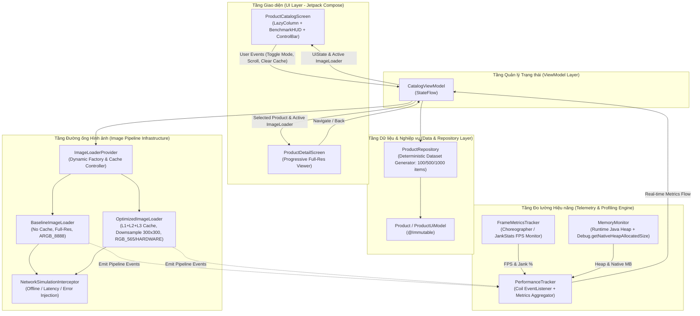
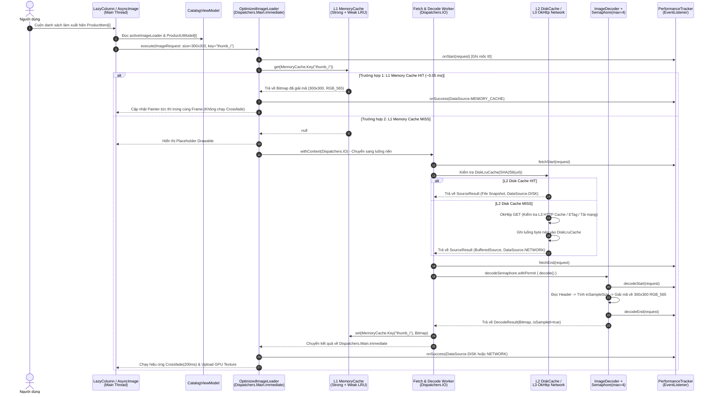
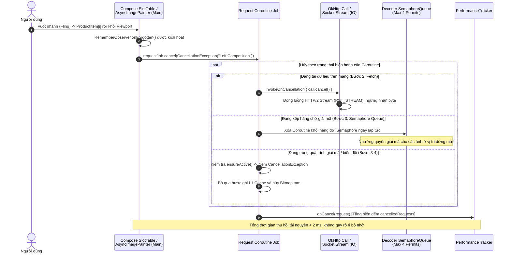
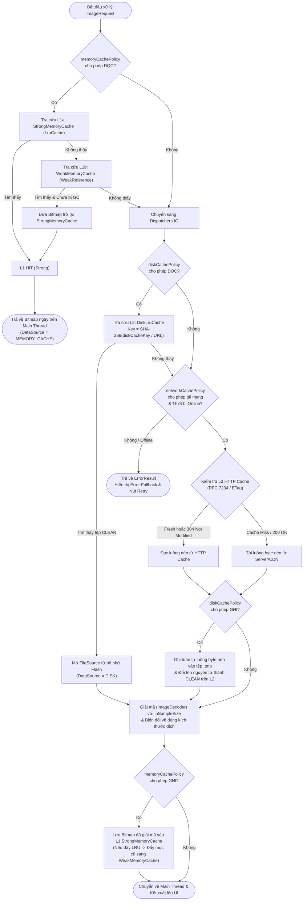

# TÀI LIỆU PHÂN TÍCH VÀ THIẾT KẾ HỆ THỐNG (DELIVERABLE D2)

**Đề tài 02:** Tối ưu tải, lưu trữ đệm và hiển thị hình ảnh trong ứng dụng Android  
**Tên ứng dụng thực nghiệm:** `ImageOptCatalog`  
**Định danh gói (Package Name):** `com.university.imageoptimization`  
**Nền tảng mục tiêu:** Android 8.0 (API 26) – Android 15 (API 35), Kotlin 1.9+, Jetpack Compose (Material 3)  

---

## MỤC LỤC

1. [Tổng quan & Yêu cầu hệ thống](#1-tổng-quan--yêu-cầu-hệ-thống)
2. [Kiến trúc tổng thể (Architecture Design)](#2-kiến-trúc-tổng-thể-architecture-design)
3. [Thiết kế chi tiết Luồng tải ảnh bất đồng bộ (Image Loading Flow)](#3-thiết-kế-chiết-tiết-luồng-tải-ảnh-bất-đồng-bộ-image-loading-flow)
4. [Thiết kế chi tiết Luồng bộ nhớ đệm đa tầng (Multi-level Cache Flow)](#4-thiết-kế-chi-tiết-luồng-bộ-nhớ-đệm-đa-tầng-multi-level-cache-flow)
5. [Thiết kế Bộ dữ liệu kiểm thử & 8 Kịch bản thực nghiệm (TC01 – TC08)](#5-thiết-kế-bộ-dữ-liệu-kiểm-thử--8-kịch-bản-thực-nghiệm-tc01--tc08)

---

## 1. Tổng quan & Yêu cầu hệ thống

### 1.1. Mục tiêu của ứng dụng `ImageOptCatalog`

Ứng dụng **`ImageOptCatalog`** là một hệ thống danh mục thương mại điện tử kiêm phòng thí nghiệm đo kiểm hiệu năng thời gian thực (**Real-time Image Optimization Testbed**). Ứng dụng được thiết kế chuyên biệt để:
1. Minh họa trực quan sự khác biệt giữa quy trình xử lý ảnh **Chưa tối ưu (`Baseline Mode`)** và **Đã tối ưu toàn diện (`Optimized Mode`)** trên cùng một bộ dữ liệu có quy mô lên tới $1,000$ sản phẩm.
2. Cung cấp hệ thống đo lường nội tại (**In-App Telemetry Engine**) thu thập tự động các chỉ số phần cứng và đường ống tải ảnh: Tốc độ khung hình (**FPS**), Tỷ lệ khung hình trễ (**Jank Rate %**), Bộ nhớ khả kiến (**Java Heap & Native Heap MB**), Thời gian giải mã (**Decode Time ms**), Thời gian tải tổng cộng (**Total Load Time ms**), Tỷ lệ trúng bộ nhớ đệm (**L1 Memory / L2 Disk / L3 Network Hit Ratio**) và Số lượng yêu cầu được hủy kịp thời khi cuộn nhanh (**Cancelled Jobs**).

### 1.2. Đặc tả Yêu cầu chức năng (Functional Requirements)

| Mã YC | Tên chức năng | Mô tả chi tiết yêu cầu kỹ thuật | Mức ưu tiên |
| :---: | :--- | :--- | :---: |
| **`FR-01`** | **Hiển thị Danh mục sản phẩm đa quy mô** | Hiển thị danh sách sản phẩm bằng `LazyColumn` (hoặc lưới `LazyVerticalGrid`). Cho phép chuyển đổi linh hoạt quy mô tập dữ liệu giữa **$100$**, **$500$** và **$1,000$** sản phẩm để đánh giá khả năng mở rộng. | Bắt buộc |
| **`FR-02`** | **Chuyển đổi chế độ `Baseline` vs `Optimized`** | Cung cấp công tắc chuyển đổi tức thì giữa hai cấu hình `ImageLoader`:<br>• **`Baseline Mode`**: Tải ảnh gốc Full-Res ($2400 \times 1600$), không downsample (`Size.ORIGINAL`), dùng `ARGB_8888`, tắt bộ nhớ đệm.<br>• **`Optimized Mode`**: Tải ảnh Thumbnail ($300 \times 300$) cho danh sách, bật Downsampling (`Precision.EXACT`), dùng `RGB_565`/`HARDWARE`, bật đầy đủ Cache 3 tầng (L1 + L2 + L3). | Bắt buộc |
| **`FR-03`** | **Màn hình Chi tiết sản phẩm (`ProductDetailScreen`)** | Khi chọn một sản phẩm, điều hướng sang màn hình chi tiết hiển thị ảnh độ phân giải cao ($1200 \times 800$ / $2400 \times 1600$). Ở chế độ `Optimized`, sử dụng ảnh Thumbnail sẵn có trong L1 Memory Cache làm `placeholderMemoryCacheKey` để hiển thị tức thì trước khi ảnh nét tải xong. | Bắt buộc |
| **`FR-04`** | **Bảng điều khiển Đo lường trực tiếp (`BenchmarkHUD`)** | Hiển thị bảng thông số thời gian thực (cập nhật mỗi $500\text{ ms}$) ngay phía trên danh sách gồm: Current FPS, Jank %, Java/Native RAM (MB), L1/L2/Network Hit counts, Avg Load Time (ms), Avg Decode Time (ms), Cancelled Requests. | Bắt buộc |
| **`FR-05`** | **Quản lý và Xóa Bộ nhớ đệm chủ động** | Cung cấp các nút điều khiển: **Xóa L1 RAM Cache**, **Xóa L2 Disk Cache**, và **Xóa toàn bộ Cache + Đặt lại số liệu (Reset Metrics)** để chuẩn bị môi trường sạch cho từng kịch bản kiểm thử `TC01`–`TC08`. | Bắt buộc |
| **`FR-06`** | **Giả lập Mất mạng / Lỗi máy chủ (`Offline & Error Simulation`)** | Cung cấp công tắc giả lập trạng thái ngoại tuyến (Offline Mode) hoặc lỗi đường truyền (tỷ lệ lỗi $30\%$ / $100\%$) để kiểm chứng khả năng đọc từ Disk Cache (`CachePolicy.READ_ONLY`), hiển thị `Error Drawable` và nút `Retry`. | Bắt buộc |
| **`FR-07`** | **Trình cuộn tự động chuẩn hóa (`Auto-Scroll Benchmark Runner`)** | Cung cấp nút bấm kích hoạt kịch bản cuộn tự động bằng mã lệnh (`animateScrollBy` / `scrollToItem` với vận tốc cố định qua $100$ hoặc $500$ mục) để loại bỏ sai số thao tác tay người khi đo đối chứng. | Khuyến nghị |
| **`FR-08`** | **Xuất báo cáo số liệu thực nghiệm (`Export Telemetry Log`)** | Xuất toàn bộ dữ liệu thống kê ($\bar{x}, s, P_{50}, P_{90}, P_{95}$) của phiên đo ra Logcat chuẩn định dạng bảng hoặc JSON/CSV để phục vụ trích xuất báo cáo học thuật. | Khuyến nghị |

### 1.3. Đặc tả Yêu cầu phi chức năng (Non-Functional Requirements)

| Mã YC | Thuộc tính chất lượng | Chỉ tiêu định lượng mục tiêu (ở chế độ `Optimized Mode`) |
| :---: | :--- | :--- |
| **`NFR-01`** | **Độ mượt giao diện (Frame Rate & Smoothness)** | Tốc độ khung hình trung bình đạt **$\ge 58\text{ FPS}$** (trên màn hình 60Hz); tỷ lệ khung hình bị trễ (**Jank Rate**) duy trì **$< 3\%$** ngay cả khi cuộn nhanh (Fling) qua $1,000$ sản phẩm. |
| **`NFR-02`** | **Hiệu quả sử dụng bộ nhớ (Memory Footprint)** | Tổng mức tăng bộ nhớ RAM (Java Heap + Native Heap) khi cuộn hết danh sách $1,000$ ảnh duy trì **$< 60\text{ MB}$**; tuyệt đối không xảy ra lỗi `java.lang.OutOfMemoryError`. |
| **`NFR-03`** | **Độ trễ truy xuất bộ nhớ đệm (Cache Latency)** | Thời gian hiển thị ảnh khi trúng L1 Memory Cache **$< 1.0\text{ ms}$** (hiển thị ngay trong cùng khung hình); khi trúng L2 Disk Cache **$< 20\text{ ms}$**. |
| **`NFR-04`** | **Độ nhạy hủy tác vụ (Cancellation Responsiveness)** | Khi một mục cuộn ra khỏi vùng nhìn (Viewport), Coroutine tải/giải mã ảnh tương ứng phải được hủy (`Job.cancel()`) trong vòng **$< 5\text{ ms}$**, giải phóng ngay lập tức kết nối mạng hoặc slot chờ `Semaphore`. |
| **`NFR-05`** | **Khả năng chống treo ứng dụng (Responsiveness)** | Không có bất kỳ thao tác mạng hoặc giải mã `Bitmap` nào chạy trên `Main Thread`; tỷ lệ lỗi **ANR = $0\%$**. |
| **`NFR-06`** | **Tính mô-đun và khả năng kiểm thử (Modularity)** | Tuân thủ nguyên tắc Tách biệt mối quan tâm (Separation of Concerns) theo kiến trúc MVVM; dễ dàng hoán đổi `ImageLoader` mà không phải sửa đổi mã nguồn tầng Giao diện (UI). |

---

## 2. Kiến trúc tổng thể (Architecture Design)

### 2.1. Mô hình kiến trúc MVVM kết hợp Clean Image Pipeline & Telemetry Engine

Hệ thống `ImageOptCatalog` được thiết kế theo kiến trúc phân tầng **MVVM (Model - View - ViewModel)** hiện đại kết hợp với **Luồng dữ liệu một chiều (Unidirectional Data Flow - UDF)** và hai mô-đun hạ tầng chuyên biệt: **`ImageLoaderProvider`** (quản lý đường ống tải ảnh đối chứng) và **`PerformanceTracker`** (động cơ thu thập số liệu hiệu năng thời gian thực).



### 2.2. Cấu trúc phân rã gói mã nguồn (`com.university.imageoptimization`)

```text
com.university.imageoptimization/
├── MainActivity.kt                        // Điểm khởi chạy, gắn kết Window FrameMetrics & Navigation
├── data/
│   ├── model/
│   │   ├── Product.kt                     // Thực thể dữ liệu sản phẩm (@Immutable)
│   │   └── OptimizationMode.kt            // Enum: BASELINE vs OPTIMIZED
│   └── repository/
│       └── ProductRepository.kt           // Khởi tạo tập dữ liệu chuẩn 100 / 500 / 1.000 items
├── image/
│   ├── ImageLoaderProvider.kt             // Quản lý khởi tạo BaselineImageLoader & OptimizedImageLoader
│   └── NetworkSimulationInterceptor.kt    // OkHttp Interceptor giả lập Offline, Timeout và HTTP 304/500
├── telemetry/
│   ├── PerformanceTracker.kt              // Triển khai Coil EventListener, tính toán P50/P95/Mean
│   ├── FrameMetricsTracker.kt             // Đo FPS và Jank Rate bằng Choreographer / FrameMetrics
│   ├── MemoryMonitor.kt                   // Đo Java Heap, Native Heap và Graphics Memory (MB)
│   └── TelemetrySnapshot.kt               // Data class chứa toàn bộ chỉ số hiển thị lên HUD
└── ui/
    ├── navigation/
    │   └── AppNavigation.kt               // Điều hướng giữa CatalogScreen và ProductDetailScreen
    ├── catalog/
    │   ├── CatalogViewModel.kt            // Quản lý trạng thái màn hình, điều phối Benchmark & Cache
    │   ├── ProductCatalogScreen.kt        // Màn hình danh sách sản phẩm tích hợp LazyColumn tối ưu
    │   └── components/
    │       ├── BenchmarkHudCard.kt        // Bảng hiển thị thông số thời gian thực (FPS, RAM, Cache)
    │       ├── ControlPanelBar.kt         // Thanh công cụ đổi chế độ, chọn quy mô, xóa Cache, Auto-scroll
    │       └── ProductItemCard.kt         // Thành phần hiển thị từng sản phẩm với AsyncImage
    └── detail/
        └── ProductDetailScreen.kt         // Màn hình xem ảnh độ phân giải cao với Cross-Screen Cache Key
```

### 2.3. Đặc tả chi tiết các lớp cốt lõi (Class Specifications)

| Tên lớp / Giao diện | Thuộc tầng | Trách nhiệm kỹ thuật chính |
| :--- | :--- | :--- |
| **`ProductCatalogScreen`** | UI Layer | Kết xuất giao diện danh sách bằng `LazyColumn` có cấu hình `key = { it.id }` và `contentType`. Tích hợp trình điều khiển cuộn tự động `LazyListState` để chạy kịch bản kiểm thử lặp lại. |
| **`ProductDetailScreen`** | UI Layer | Hiển thị thông tin chi tiết sản phẩm và ảnh lớn ($1200 \times 800\text{ px}$). Sử dụng `placeholderMemoryCacheKey("thumb_${product.id}")` để tái sử dụng ngay lập tức `Bitmap` thu nhỏ từ L1 Cache trong khi chờ tải ảnh lớn. |
| **`CatalogViewModel`** | State Layer | Lưu giữ `StateFlow<CatalogUiState>`, xử lý các sự kiện chuyển đổi chế độ `OptimizationMode.BASELINE` $\leftrightarrow$ `OptimizationMode.OPTIMIZED`, thay đổi kích thước tập dữ liệu ($100/500/1000$), kích hoạt lệnh dọn bộ nhớ đệm và thu thập luồng dữ liệu từ `PerformanceTracker`. |
| **`ProductRepository`** | Data Layer | Sinh bộ dữ liệu sản phẩm tất định (deterministic) với hạt giống cố định. Mỗi sản phẩm chứa 2 URL riêng biệt: `thumbnailUrl` ($300 \times 300\text{ px}$) và `fullResUrl` ($2400 \times 1600\text{ px}$). |
| **`ImageLoaderProvider`** | Image Pipeline | Cung cấp hai thực thể `coil.ImageLoader` độc lập hoặc cấu hình động: `baselineImageLoader` và `optimizedImageLoader`. Cung cấp phương thức `clearMemoryCache()`, `clearDiskCache()` và đọc dung lượng thực tế đang chiếm dụng của từng tầng Cache. |
| **`PerformanceTracker`** | Telemetry Layer | Triển khai `coil.EventListener.Factory`. Ghi nhận thời gian bắt đầu/kết thúc của từng pha `fetch`, `decode`, `transform` và tổng thời gian yêu cầu. Tính toán thống kê thời gian thực ($\text{Mean}$, $P_{50}$, $P_{95}$, tỷ lệ trúng L1/L2/L3) và phát qua `StateFlow<TelemetrySnapshot>`. |

---

## 3. Thiết kế chi tiết Luồng tải ảnh bất đồng bộ (Image Loading Flow)

### 3.1. Luồng tải và hiển thị ảnh thành công (Normal Asynchronous Loading Sequence)

Sơ đồ tuần tự dưới đây mô tả chi tiết sự phối hợp giữa các luồng (`Main Thread`, `Dispatchers.IO`, `Decoder Semaphore Pool`, `RenderThread`) từ khi một mục trong `LazyColumn` đi vào vùng nhìn cho đến khi điểm ảnh xuất hiện trên màn hình:



### 3.2. Luồng Hủy tác vụ khi người dùng cuộn nhanh (High-Velocity Fling Cancellation Flow)

Khi người dùng thực hiện thao tác vuốt nhanh (**Fling**), các mục đi qua màn hình rồi biến mất chỉ sau vài chục mili-giây. Sơ đồ dưới đây thể hiện cơ chế hủy hợp tác (**Cooperative Cancellation**) giúp giải phóng tài nguyên ngay lập tức:



---

## 4. Thiết kế chi tiết Luồng bộ nhớ đệm đa tầng (Multi-level Cache Flow)

### 4.1. Lưu đồ thuật toán tra cứu và ghi ngược bộ nhớ đệm 3 tầng



### 4.2. Bảng đối chiếu cấu hình kỹ thuật: `BaselineImageLoader` vs `OptimizedImageLoader`

Để phục vụ việc so sánh định lượng trong 8 kịch bản thực nghiệm, `ImageLoaderProvider` cung cấp hai cấu hình đối lập rõ rệt:

| Tham số cấu hình kỹ thuật | `BaselineImageLoader` (Chế độ Chưa tối ưu) | `OptimizedImageLoader` (Chế độ Đã tối ưu) | Ý nghĩa kỹ thuật của sự khác biệt |
| :--- | :--- | :--- | :--- |
| **Độ phân giải URL sử dụng ở Danh sách** | `product.fullResUrl` ($2400 \times 1600\text{ px}$ hoặc $3840 \times 2160\text{ px}$) | `product.thumbnailUrl` ($300 \times 300\text{ px}$ WebP) | Giảm $85\% - 92\%$ băng thông tải mạng cho màn hình danh sách. |
| **Kích thước giải mã mục tiêu (`Size`)** | `Size.ORIGINAL` (Giải mã toàn bộ số pixel gốc) | `Size(300, 300)` ở danh sách; `Size(1200, 800)` ở chi tiết | Ngăn chặn việc cấp phát `Bitmap` khổng lồ vượt quá kích thước khung nhìn vật lý. |
| **Độ chính xác co giãn (`Precision`)** | `Precision.INEXACT` (Không ép hạ mẫu theo khung) | `Precision.EXACT` kết hợp `Scale.FILL` | Đảm bảo `inSampleSize` và ma trận thu phóng khớp chính xác từng pixel của ô hiển thị. |
| **Cấu hình điểm ảnh (`Bitmap.Config`)** | `Bitmap.Config.ARGB_8888` ($4\text{ bytes/pixel}$), `allowHardware(false)` | `Bitmap.Config.RGB_565` ($2\text{ bytes/pixel}$) cho ảnh không trong suốt + `allowHardware(true)` | Giảm ngay $50\%$ dung lượng RAM mỗi pixel hoặc đẩy thẳng sang bộ nhớ đồ họa GPU (`GraphicBuffer`). |
| **Tầng L1 Memory Cache** | `CachePolicy.DISABLED` (Hoặc tắt hoàn toàn L1 trong các bài đo Cold/Disk) | `CachePolicy.ENABLED` (`maxSizePercent = 0.25` $\approx 64\text{ MB}$, bật cả `Strong` + `Weak`) | Cho phép truy xuất tức thì ($\approx 0.05\text{ ms}$) khi cuộn ngược lại các mục vừa xem. |
| **Tầng L2 Disk Cache** | `CachePolicy.DISABLED` | `CachePolicy.ENABLED` (Dung lượng $100\text{ MB}$ tại `cacheDir/image_opt_disk_cache`) | Lưu trữ bền vững qua các lần tắt/mở ứng dụng và hỗ trợ chế độ xem Offline. |
| **Tầng L3 HTTP Cache & OkHttp Pool** | Không dùng HTTP Cache; `Dispatcher.maxRequestsPerHost = 5` | Bật `okhttp3.Cache` ($20\text{ MB}$), hỗ trợ `ETag`/`304`, `maxRequestsPerHost = 16` | Tăng tốc độ ghép kênh HTTP/2 và tiết kiệm băng thông khi xác thực lại ảnh. |
| **Giới hạn luồng giải mã song song** | Không giới hạn hợp lý hoặc giải mã ảnh gốc nặng gây nghẽn | `bitmapFactoryMaxParallelism(4)` trên `Dispatchers.IO` | Ngăn chặn hiện tượng tăng vọt RAM đồng thời (Memory Spike) và tranh chấp CPU. |
| **Cầu nối bộ nhớ đệm liên màn hình** | Không sử dụng (`placeholderMemoryCacheKey = null`) | Bật `placeholderMemoryCacheKey("thumb_${product.id}")` | Hiển thị ngay ảnh thu nhỏ ở màn hình chi tiết trong $0\text{ ms}$ trước khi ảnh nét tải xong. |

### 4.3. Thiết kế mã nguồn `ImageLoaderProvider.kt`

```kotlin
package com.university.imageoptimization.image

import android.content.Context
import android.graphics.Bitmap
import coil.ImageLoader
import coil.disk.DiskCache
import coil.memory.MemoryCache
import coil.request.CachePolicy
import com.university.imageoptimization.telemetry.PerformanceTracker
import okhttp3.Cache
import okhttp3.Dispatcher
import okhttp3.OkHttpClient
import java.io.File
import java.util.concurrent.TimeUnit

/**
 * Cung cấp và quản lý vòng đời của 2 bộ tải ảnh đối chứng:
 * 1. BaselineImageLoader (Chưa tối ưu)
 * 2. OptimizedImageLoader (Đã tối ưu hóa toàn diện)
 */
class ImageLoaderProvider(
    private val context: Context,
    private val performanceTracker: PerformanceTracker,
    private val networkInterceptor: NetworkSimulationInterceptor
) {
    private val diskCacheDir = File(context.cacheDir, "coil_optimized_disk_cache")
    private val httpCacheDir = File(context.cacheDir, "okhttp_http_cache")

    /**
     * Cấu hình Baseline: Không dùng bộ nhớ đệm, giải mã ARGB_8888, tắt Hardware Bitmap.
     */
    val baselineImageLoader: ImageLoader by lazy {
        val baselineOkHttp = OkHttpClient.Builder()
            .addInterceptor(networkInterceptor)
            .connectTimeout(15, TimeUnit.SECONDS)
            .readTimeout(20, TimeUnit.SECONDS)
            .build()

        ImageLoader.Builder(context)
            .okHttpClient(baselineOkHttp)
            .memoryCachePolicy(CachePolicy.DISABLED)
            .diskCachePolicy(CachePolicy.DISABLED)
            .networkCachePolicy(CachePolicy.ENABLED)
            .bitmapConfig(Bitmap.Config.ARGB_8888)
            .allowHardware(false)
            .allowRgb565(false)
            .eventListener(performanceTracker)
            .build()
    }

    /**
     * Cấu hình Optimized: Bộ nhớ đệm 3 tầng (L1 25% RAM + L2 100MB Disk + L3 20MB HTTP),
     * ưu tiên RGB_565 / Hardware Bitmap, giới hạn 4 luồng giải mã song song.
     */
    val optimizedImageLoader: ImageLoader by lazy {
        val dispatcher = Dispatcher().apply {
            maxRequests = 64
            maxRequestsPerHost = 16
        }

        val optimizedOkHttp = OkHttpClient.Builder()
            .dispatcher(dispatcher)
            .cache(Cache(directory = httpCacheDir, maxSize = 20L * 1024 * 1024)) // L3: 20 MB
            .addInterceptor(networkInterceptor)
            .connectTimeout(10, TimeUnit.SECONDS)
            .readTimeout(15, TimeUnit.SECONDS)
            .build()

        ImageLoader.Builder(context)
            .okHttpClient(optimizedOkHttp)
            // Tầng L1: Memory Cache (Strong LruCache 25% Heap + WeakReference Cache)
            .memoryCache {
                MemoryCache.Builder(context)
                    .maxSizePercent(0.25)
                    .strongReferencesEnabled(true)
                    .weakReferencesEnabled(true)
                    .build()
            }
            // Tầng L2: Disk Cache (100 MB trên bộ nhớ Flash nội bộ)
            .diskCache {
                DiskCache.Builder()
                    .directory(diskCacheDir)
                    .maxSizeBytes(100L * 1024 * 1024) // 100 MB
                    .build()
            }
            .memoryCachePolicy(CachePolicy.ENABLED)
            .diskCachePolicy(CachePolicy.ENABLED)
            .networkCachePolicy(CachePolicy.ENABLED)
            // Tối ưu hóa định dạng điểm ảnh và luồng giải mã
            .bitmapConfig(Bitmap.Config.RGB_565)
            .allowRgb565(true)
            .allowHardware(true)
            .bitmapFactoryMaxParallelism(4)
            .respectCacheHeaders(false) // Chủ động quản lý vòng đời qua L2 DiskCache
            .crossfade(200)
            .eventListener(performanceTracker)
            .build()
    }

    fun clearAllCaches() {
        baselineImageLoader.memoryCache?.clear()
        baselineImageLoader.diskCache?.clear()
        optimizedImageLoader.memoryCache?.clear()
        optimizedImageLoader.diskCache?.clear()
    }
}
```

---

## 5. Thiết kế Bộ dữ liệu kiểm thử & 8 Kịch bản thực nghiệm (`TC01` – `TC08`)

### 5.1. Thiết kế Bộ dữ liệu kiểm thử chuẩn hóa (Deterministic Benchmark Dataset)

Để mọi phép đo giữa `Baseline Mode` và `Optimized Mode` hoàn toàn công bằng và có thể tái lập 100%, lớp `ProductRepository` khởi tạo tập dữ liệu sản phẩm với hạt giống cố định (**Deterministic Seed**):

- **Quy mô tùy chọn:** $N \in \{100, 500, 1000\}$ sản phẩm.
- **Cấu trúc URL phân tách độ phân giải:** Mỗi sản phẩm thứ $i$ ($1 \le i \le 1000$) sở hữu định danh ổn định `id = "PROD_%04d".format(i)` và hai đường dẫn ảnh riêng biệt:
  - **`thumbnailUrl` (Dùng cho Danh sách ở chế độ Optimized):** Độ phân giải **$300 \times 300\text{ px}$** (ví dụ: `https://picsum.photos/seed/prod_0001/300/300.webp`, dung lượng tệp $\approx 14\text{ KB} - 25\text{ KB}$).
  - **`fullResUrl` (Dùng cho Chi tiết ở chế độ Optimized, và dùng cho cả Danh sách ở chế độ Baseline):** Độ phân giải **$2400 \times 1600\text{ px}$** (hoặc $3840 \times 2160\text{ px}$, dung lượng tệp $\approx 350\text{ KB} - 850\text{ KB}$, dung lượng giải mã `ARGB_8888` $= 14.65\text{ MB} - 31.64\text{ MB}$ mỗi ảnh).

### 5.2. Ma trận tổng quan 8 Kịch bản thực nghiệm (`TC01` – `TC08`)

| Mã kịch bản | Tên kịch bản thực nghiệm | Quy mô dữ liệu | Trạng thái Cache ban đầu | Trọng tâm đánh giá khoa học |
| :---: | :--- | :---: | :--- | :--- |
| **`TC01`** | **Cold Start / Cold Cache Network Load** | $100$ items | L1 Trống, L2 Trống | So sánh thời gian hiển thị ảnh lần đầu từ mạng ($T_{\text{load}}, P_{50}, P_{95}$) và băng thông tiêu thụ. |
| **`TC02`** | **Warm Cache Load (L2 Disk Cache Hit)** | $100$ items | L1 Trống, **L2 Đầy đủ** | Đánh giá tốc độ khôi phục ảnh từ bộ nhớ Flash nội bộ (`DataSource.DISK`) khi mở lại ứng dụng. |
| **`TC03`** | **Hot Cache Load (L1 Memory Cache Hit)** | $100$ items | **L1 Đầy đủ**, L2 Đầy đủ | Kiểm chứng độ trễ truy xuất tức thì ($\approx 0.05\text{ ms}$) từ `LruCache` trên RAM khi cuộn ngược lại. |
| **`TC04`** | **Downsampling & `Bitmap.Config` Impact** | $100$ items | L1 Trống, L2 Đầy đủ | Đo lường mức giảm dung lượng RAM (Native Heap MB) và thời gian CPU giải mã (`decodeDurationMs`). |
| **`TC05`** | **High-Velocity Fling Scroll & Cancellation** | $500$ items | L1 Trống, L2 Trống | Kiểm chứng cơ chế hủy Coroutine (`Job.cancel()`), tốc độ khung hình (FPS) và tỷ lệ Jank (%) khi vuốt nhanh. |
| **`TC06`** | **Cross-Screen Progressive Transition** | $100$ items | L1 Đã có Thumbnail | Đánh giá trải nghiệm chuyển từ Danh sách sang Chi tiết sản phẩm với `placeholderMemoryCacheKey`. |
| **`TC07`** | **Offline Resilience & Error Recovery** | $100$ items | L1 Trống, L2 Có $50\%$ | Kiểm chứng khả năng hoạt động khi mất mạng (Offline đọc từ L2 Disk Cache) và cơ chế Fallback/Retry. |
| **`TC08`** | **Extreme Memory Stress Test (1.000 Items)** | **$1,000$ items** | L1 Trống, L2 Trống | Kiểm thử độ bền bộ nhớ dài hạn, tần suất GC Pause, hiện tượng Memory Churn và khả năng chống lỗi OOM. |

---

### 5.3. Đặc tả chi tiết từng Kịch bản thực nghiệm (`TC01` – `TC08`)

#### Kịch bản `TC01`: Tải danh sách lần đầu từ mạng (Cold Start / Cold Cache Network Load)
- **Mục tiêu:** Đánh giá hiệu năng tải và hiển thị ảnh khi ứng dụng vừa cài đặt mới hoặc vừa xóa sạch toàn bộ dữ liệu đệm (100% yêu cầu phải đi qua mạng).
- **Đầu vào:** Tập dữ liệu $N = 100$ sản phẩm; chế độ mạng Wi-Fi/4G ổn định ($20\text{ Mbps}$).
- **Biến kiểm soát (Controlled Variables):**
  - Trước mỗi lần đo (cả `Baseline` và `Optimized`), bắt buộc bấm nút **"Clear All Caches & Reset Metrics"** để xóa sạch L1 RAM, L2 Disk và L3 HTTP Cache.
  - Cùng cuộn tự động qua $30$ sản phẩm đầu tiên với vận tốc cố định ($300\text{ dp/giây}$).
- **Các bước thực hiện:**
  1. Chọn chế độ `Baseline Mode` $\rightarrow$ Nhấn `Clear All Caches` $\rightarrow$ Nhấn `Run Auto-Scroll (30 items)` $\rightarrow$ Ghi nhận số liệu.
  2. Chuyển sang `Optimized Mode` $\rightarrow$ Nhấn `Clear All Caches` $\rightarrow$ Nhấn `Run Auto-Scroll (30 items)` $\rightarrow$ Ghi nhận số liệu.
  3. Lặp lại $n = 5$ lần cho mỗi chế độ.
- **Chỉ số đầu ra cần đo (Output Metrics):**
  - Thời gian tải ảnh trung bình ($\bar{x}$), trung vị ($P_{50}$) và phân vị thứ 95 ($P_{95}$) tính bằng $\text{ms}$.
  - Tổng dung lượng dữ liệu mạng tải về ($\text{MB}$) và tỷ lệ `DataSource.NETWORK` ($= 100\%$).

---

#### Kịch bản `TC02`: Tải lại danh sách khi đã có Disk Cache (Warm Cache - L2 Disk Hit)
- **Mục tiêu:** Đo lường lợi ích của tầng **L2 Disk Cache (`DiskLruCache`)** khi người dùng đóng ứng dụng và mở lại (RAM đã bị giải phóng nhưng tệp nén trên bộ nhớ Flash vẫn còn).
- **Đầu vào:** Tập dữ liệu $N = 100$ sản phẩm; $30$ sản phẩm đầu tiên đã được tải hoàn tất từ `TC01`.
- **Biến kiểm soát:**
  - Chỉ xóa **L1 Memory Cache** (`Clear RAM Cache`), **giữ nguyên L2 Disk Cache**.
  - Cùng cuộn qua đúng $30$ sản phẩm đầu tiên đã nạp ở `TC01`.
- **Các bước thực hiện:**
  1. Sau khi hoàn tất `TC01` ở chế độ `Optimized`, nhấn nút **`Clear RAM Cache Only`** (L1 $= 0\text{ MB}$, L2 giữ nguyên).
  2. Cuộn lại từ mục $1$ đến mục $30$ $\rightarrow$ Ghi nhận thời gian đọc và giải mã từ đĩa.
  3. So sánh với chế độ `Baseline` (do không có Disk Cache nên vẫn phải tải lại từ mạng).
- **Chỉ số đầu ra cần đo:**
  - Tỷ lệ trúng bộ nhớ đệm đĩa (`Disk Cache Hit Rate %` — kỳ vọng đạt $100\%$ ở chế độ `Optimized`).
  - Thời gian hoàn tất yêu cầu trung bình ($\text{ms}$) giảm từ $\sim 250\text{ ms}$ (Mạng) xuống còn $\sim 8 - 18\text{ ms}$ (Đọc đĩa + Giải mã).
  - Lưu lượng mạng tiêu thụ ($= 0\text{ KB}$ ở chế độ `Optimized`).

---

#### Kịch bản `TC03`: Cuộn qua lại các mục đã hiển thị trên RAM (Hot Cache - L1 Memory Hit)
- **Mục tiêu:** Chứng minh tốc độ truy xuất tức thì ($\approx 0.05\text{ ms}$) và chi phí giải mã CPU bằng $0$ của tầng **L1 Memory Cache (`LruCache` + `WeakMemoryCache`)** kết hợp `Dispatchers.Main.immediate`.
- **Đầu vào:** $30$ sản phẩm đầu tiên đã được hiển thị và đang nằm trong L1 Memory Cache.
- **Biến kiểm soát:** Không xóa bất kỳ tầng Cache nào; thực hiện cuộn xuống mục $30$ rồi cuộn ngược lên mục $1$.
- **Các bước thực hiện:**
  1. Đặt lại bộ đếm thống kê (`Reset Telemetry Counters` mà không xóa Cache).
  2. Cuộn từ mục $30$ ngược về mục $1$ rồi lại xuống mục $30$.
  3. Đối chiếu giữa `Baseline` và `Optimized`.
- **Chỉ số đầu ra cần đo:**
  - Tỷ lệ trúng bộ nhớ đệm RAM (`Memory Cache Hit Rate %` — kỳ vọng đạt $\ge 95\%$ ở `Optimized`).
  - Thời gian tải ảnh trung bình ($\bar{x} < 0.5\text{ ms}$), thời gian giải mã CPU (`Avg Decode Time` $= 0.0\text{ ms}$).
  - Hiện tượng thị giác: Ở `Optimized`, ảnh xuất hiện tức thì không có khung hình chớp `Placeholder`; ở `Baseline`, ảnh bị chớp trắng và phải tải/giải mã lại.

---

#### Kịch bản `TC04`: Đánh giá hiệu quả của Downsampling & `Bitmap.Config` đối với RAM và CPU Decode
- **Mục tiêu:** Tách biệt và định lượng chính xác tác động của kỹ thuật hạ mẫu (`inSampleSize` về $300 \times 300\text{ px}$, `Precision.EXACT`) và cấu hình điểm ảnh (`RGB_565` / `HARDWARE`) so với việc giải mã ảnh gốc (`Size.ORIGINAL`, `ARGB_8888`).
- **Đầu vào:** Tập dữ liệu $N = 100$ sản phẩm với cùng nguồn ảnh độ phân giải cao.
- **Biến kiểm soát:** Cố định nguồn đọc từ bộ nhớ cục bộ (L2 Disk Cache) để loại bỏ hoàn toàn biến thiên độ trễ mạng, chỉ đo thuần túy **CPU Decode Time** và **RAM Allocation**.
- **Các bước thực hiện:**
  1. Chạy cấu hình `Unsampled ARGB_8888` ($2400 \times 1600 \times 4\text{ bytes} = 15.36\text{ MB/ảnh}$) qua $50$ mục $\rightarrow$ Ghi nhận đỉnh bộ nhớ Native Heap và thời gian `decodeEnd - decodeStart`.
  2. Chạy cấu hình `Downsampled 300x300 RGB_565` ($300 \times 300 \times 2\text{ bytes} = 180\text{ KB/ảnh}$) qua $50$ mục $\rightarrow$ Ghi nhận kết quả.
- **Chỉ số đầu ra cần đo:**
  - Thời gian giải mã trung bình 1 bức ảnh (`Avg Decode Duration ms` — kỳ vọng giảm từ $\sim 45 - 90\text{ ms}$ xuống còn $< 5\text{ ms}$).
  - Mức tiêu thụ **Native Heap & Graphics Memory (MB)** trên Android Studio Memory Profiler và `MemoryMonitor`.
  - Số lượng sự kiện thu gom rác (**GC Count** và **GC Pause Duration ms**) trong Logcat.

---

#### Kịch bản `TC05`: Cuộn nhanh tốc độ cao (High-Velocity Fling) & Kiểm chứng cơ chế Hủy (`Job.cancel()`)
- **Mục tiêu:** Đánh giá khả năng giữ nhịp khung hình 60 FPS / 120 FPS và hiệu quả giải phóng tài nguyên của cơ chế **Structured Concurrency (`Job.cancel()`)** khi người dùng vuốt cực nhanh qua danh sách lớn.
- **Đầu vào:** Tập dữ liệu $N = 500$ sản phẩm; Cache ban đầu trống (Cold Cache).
- **Biến kiểm soát:** Sử dụng lệnh cuộn nhanh tự động (`Fling Benchmark`: cuộn từ mục $1$ đến mục $300$ trong vòng $3\text{ giây}$).
- **Các bước thực hiện:**
  1. Khởi chạy `Fling Benchmark` ở chế độ `Baseline` (không hủy hoặc giải mã ảnh gốc nặng làm nghẽn `Semaphore` và `RenderThread`).
  2. Khởi chạy `Fling Benchmark` ở chế độ `Optimized` (có `key`, `contentType`, hủy Coroutine tức thì khi mục rời khỏi Composition).
- **Chỉ số đầu ra cần đo:**
  - **Số lượng yêu cầu đã hủy kịp thời (`Cancelled Requests Count`)**: Phản ánh bao nhiêu mục bị lướt qua đã được ngắt kết nối trước khi tốn CPU giải mã.
  - **Thời gian chờ hiển thị ảnh tại điểm dừng cuối (Settling Time ms)**: Thời gian từ khi danh sách dừng lại ở mục $300$ cho đến khi 6 bức ảnh trên màn hình hiện đầy đủ.
  - **Tốc độ khung hình trung bình (Avg FPS)** và **Tỷ lệ khung hình giật (Jank Rate %)** đo qua `FrameMetricsTracker`.

---

#### Kịch bản `TC06`: Chuyển màn hình Danh sách $\rightarrow$ Chi tiết (`Cross-Screen Progressive Loading`)
- **Mục tiêu:** Kiểm chứng chiến lược phân tách Thumbnail ($300 \times 300$) và Full-Res ($1200 \times 800$), đồng thời đánh giá hiệu quả của `placeholderMemoryCacheKey` khi điều hướng giữa các màn hình.
- **Đầu vào:** Màn hình danh sách đã hiển thị sản phẩm `PROD_0005` (Thumbnail đã nằm trong L1 Memory Cache).
- **Biến kiểm soát:** Cùng tốc độ mạng; so sánh khi có và không có `placeholderMemoryCacheKey("thumb_PROD_0005")`.
- **Các bước thực hiện:**
  1. Nhấn vào sản phẩm `PROD_0005` để mở `ProductDetailScreen`.
  2. Đo thời gian đến khi khung ảnh chi tiết có hình ảnh đầu tiên (**Time to First Visual - TTFV**) và thời gian đến khi ảnh độ phân giải cao hoàn tất (**Time to Full Resolution - TTFR**).
- **Chỉ số đầu ra cần đo:**
  - **Time to First Visual (TTFV):** Ở chế độ `Optimized`, $\text{TTFV} \approx \mathbf{0\text{ ms}}$ (hiển thị ngay ảnh Thumbnail từ RAM), trong khi `Baseline` phải nhìn khung trống trong suốt $200 - 500\text{ ms}$.
  - **Time to Full Resolution (TTFR):** Thời gian tải hoàn tất bức ảnh $1200 \times 800\text{ px}$ sắc nét.

---

#### Kịch bản `TC07`: Kiểm thử khả năng chịu lỗi mạng, Chế độ Offline và Retry/Fallback
- **Mục tiêu:** Đánh giá tính bền vững (Resilience) của ứng dụng khi mất kết nối Internet hoặc máy chủ ảnh gặp sự cố HTTP 500 / Timeout.
- **Đầu vào:** Tập dữ liệu $N = 100$ sản phẩm, trong đó $20$ sản phẩm đầu đã từng được xem (đã lưu trong L2 Disk Cache), $80$ sản phẩm tiếp theo chưa từng tải.
- **Biến kiểm soát:** Bật công tắc **`Simulate Offline Mode`** trên thanh điều khiển (chặn toàn bộ kết nối mạng tại `NetworkSimulationInterceptor`).
- **Các bước thực hiện:**
  1. Bật `Simulate Offline Mode` $\rightarrow$ Xóa L1 RAM Cache $\rightarrow$ Cuộn từ mục $1$ đến mục $40$.
  2. Quan sát mục $1 \rightarrow 20$ (đã có trong L2 Disk Cache) và mục $21 \rightarrow 40$ (chưa có trong L2 Disk Cache).
  3. Tắt `Simulate Offline Mode` (khôi phục mạng) $\rightarrow$ Nhấn nút **`Retry Failed Images`** trên các mục bị lỗi.
- **Chỉ số đầu ra cần đo:**
  - Tỷ lệ hiển thị thành công ngoại tuyến cho các mục đã lưu đệm ($100\%$ cho mục $1 \rightarrow 20$ ở chế độ `Optimized` nhờ L2 Disk Cache; $0\%$ ở chế độ `Baseline`).
  - Thời gian phản hồi hiển thị `Error Fallback Drawable` và tỷ lệ khôi phục thành công sau khi nhấn `Retry` ($100\%$).

---

#### Kịch bản `TC08`: Kiểm thử áp lực bộ nhớ cực hạn (Extreme Stress Test — 1.000 Items)
- **Mục tiêu:** Kiểm tra giới hạn chịu tải của kiến trúc quản lý bộ nhớ khi người dùng duyệt liên tục qua danh sách quy mô lớn ($1,000$ sản phẩm), đánh giá cơ chế tự động đẩy mục cũ (`LRU Eviction`) của L1/L2 Cache và chứng minh khả năng miễn nhiễm với lỗi `OutOfMemoryError` (OOM).
- **Đầu vào:** Tập dữ liệu tối đa **$N = 1,000$ sản phẩm**.
- **Biến kiểm soát:** Cuộn liên tục từ mục $1$ đến mục $1,000$ trong thời gian $45\text{ giây}$.
- **Các bước thực hiện:**
  1. Chạy bài kiểm thử cuộn $1,000$ mục ở chế độ `Baseline` (theo dõi thời điểm xảy ra giật đứng khung hình, GC Pause liên tục hoặc văng ứng dụng do `OutOfMemoryError`).
  2. Chạy bài kiểm thử cuộn $1,000$ mục ở chế độ `Optimized` (theo dõi sự ổn định của đường biểu diễn RAM khi L1 `LruCache` chạm ngưỡng trần $25\%$ Heap và bắt đầu evict các `Bitmap` cũ).
- **Chỉ số đầu ra cần đo:**
  - **Đỉnh bộ nhớ tiêu thụ (Peak Java Heap + Peak Native Heap MB):** Chứng minh đồ thị bộ nhớ của `Optimized Mode` đi ngang (tiệm cận ngưỡng trần $LruCache \approx 50 - 65\text{ MB}$) thay vì tăng tuyến tính đến khi tràn bộ nhớ.
  - **Tần suất và tổng thời gian dừng của Bộ thu gom rác (Total GC Pause ms)**.
  - **Tỷ lệ sống sót của tiến trình (Crash / OOM / ANR Count $= 0$)**.
